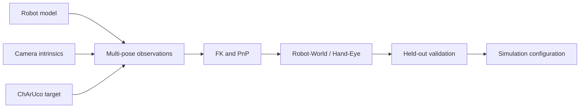
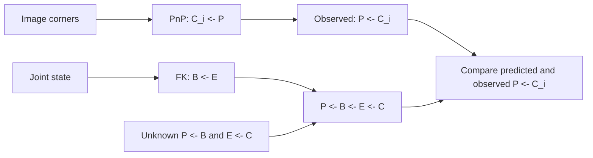
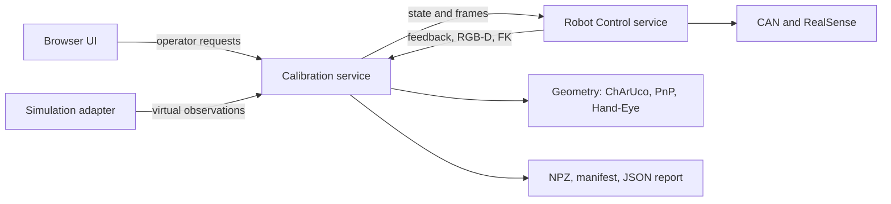

RoboTwin can simulate a Piper-X arm using its robot model, but the positions of the robots and cameras in the scene may differ from their installation on a real workbench. The two bases might be closer together, or a wrist camera might point at a slightly different angle. As a result, the same joint configuration can produce different camera views in simulation and on the physical robot.

To reproduce the workcell more closely, we need to measure the positions and orientations of its robots and cameras relative to one another. This process is called **workcell geometric calibration**.

The workcell here has two Piper-X arms, two wrist-mounted D435 cameras, and one fixed third-view D435. Each arm captures a stationary ChArUco board from several poses. We combine the images with joint feedback to estimate the base positions and camera mounts, check the results, and express them in the coordinate frame used by RoboTwin.

<Callout title="About the recorded example">
The example uses RGB images rendered in RoboTwin/SAPIEN and joint feedback read from the simulated robots. The calibration software processes these records and replays them in the operator interface. No physical Piper-X or D435 was connected. The results demonstrate the method in simulation; they do not establish accuracy or motion safety on a physical workcell.
</Callout>

## 1. Calibration objectives and parameter sources

### Known and Unknown

The official Piper-X model describes the links and joints. Given the current joint angles, it lets us calculate where the end effector is relative to the robot base. It does not tell us where that base is installed on the table or how an additional camera is attached to the wrist. Those relationships must be measured for the assembled workcell.

A camera also needs two types of geometric information. **Intrinsics** describe how it forms an image, including focal length, principal point, and lens distortion. **Extrinsics** describe its position and orientation relative to another coordinate frame, such as the robot end or the calibration board. We read intrinsics from the active camera stream and estimate the installation extrinsics from images and robot feedback.

The following table separates information available from the devices and models from the relationships we need to estimate. Forward kinematics (FK) calculates the end-effector pose from joint angles. Perspective-n-Point (PnP) estimates a known object's pose from its image. We will use both after checking the robot model and board geometry.

| Data | Source | Purpose |
| --- | --- | --- |
| Links, joint axes, limits, and dimensions | Official URDF/Xacro, meshes, and control interface | Build the simulated robot and calculate its end pose |
| Actual joint positions | Robot feedback; joint state in simulation | Pair each image with a robot pose |
| Intrinsics, distortion, and image size | D435 SDK for the active color stream | Relate known target points to image pixels |
| Wrist camera relative to the end reference | Images and end poses from several arm configurations | Hand–eye extrinsic |
| Each base relative to the fixed target | Solve each arm independently | A common reference for both arms |
| Fixed camera relative to the target | Target detection and PnP | Fixed-camera extrinsic |

The measurements are connected in this order:



### Installation transforms and measurement limits

The center of a camera housing is not necessarily the optical center. Two bases can have the right separation and still differ in height, fore–aft position, or orientation. A single distance and a pitch angle cannot describe those differences.

We therefore estimate both position and orientation, together called a **pose**. A rigid transform represents that pose with three translation components and three rotational degrees of freedom. These transforms belong to SE(3), the group of rigid-body transforms in three-dimensional space.

Using the stationary board as a common reference, calibration estimates two base poses, two wrist-camera mounts relative to their respective end frames, and the fixed camera pose. Base separation and camera height are useful summaries, but applying the result requires the full transforms.

The software saves those transforms, the observations, and a quality report. Applying them to a RoboTwin task is a separate step; exporting a result does not change the task's environment files.

## 2. Robot models and coordinate frames

### Robot model and kinematic verification

Before using camera images to calibrate the installation, check that the robot model calculates the correct end-effector pose. **Forward kinematics (FK)** calculates that pose from the joint angles and the geometry of the links and joints. Hand-eye calibration uses the FK result at every recorded pose, so an incorrect joint order, rotation direction, or tool offset can lead to an incorrect camera mount even when the board is clearly visible.

Piper-X's URDF describes how its links and joints connect and move. It is available from the [official AgileX agx_arm_urdf repository](https://github.com/agilexrobotics/agx_arm_urdf). The recorded model sources are:

```text title="Official model source paths"
piper_x/urdf/piper_x_description.urdf
piper_x/urdf/piper_x_with_gripper_description.xacro
```

Mesh files provide the visible and collision shapes. Xacro uses variables and macros to organize a robot description; it usually needs expansion before a general URDF loader can read it. Importing the model into SAPIEN may also require resolving ROS resource paths, handling coupled gripper joints, and adding camera nodes.

Check several known, stationary robot configurations against the controller's feedback. Confirm joint order, signs, zero positions, and length units, then compare the end position and orientation using the same end reference. A model can look correct while using different joint conventions.

The standalone calibration scene uses a pinned Piper-X resource bundle prepared by the installation script. It contains the robots, table, lights, and cameras without task objects or policy code. [RoboTwin-PiperX](https://github.com/Max-Lii/RoboTwin-PiperX) shows how the adapted model is organized in complete task environments. For another robot, obtain the correct model from its manufacturer and check its resources and license before adapting it.

### End reference, TCP, and camera optical frame

<Figure src="/images/piper_coordinate_frames_figure.webp" alt="Piper-X full view and wrist detail with base, link6, tool, and optical frames" caption="Frame illustration: B is the base, E denotes link6 in this drawing, TCP is a tool reference, and C is the OpenCV optical frame. An illustrated camera mounting pose does not replace real hand–eye calibration." />

A pose needs a reference point and a set of axis directions. Several frames near the gripper are useful, but they describe different locations:

<div className="reference-table">

| Reference | Symbol | Meaning and convention |
| --- | --- | --- |
| Robot base | B | The robot's own reference frame, usually `base_link`. FK expresses the end pose relative to this frame. |
| End reference | E | The output frame of the FK calculation used during capture. The drawing uses `link6`; the capture interface may include an additional tool transform. |
| Tool center point | TCP | The point chosen for manipulation, such as a point between or beyond the fingers. Its associated frame can be defined by an offset without adding a separate URDF link. |
| Camera optical frame | C | The frame used for image projection. OpenCV uses X to image right, Y down, and Z forward along the viewing direction. |

</div>

End effector is often abbreviated **EE** in interfaces. When an interface reports its pose, it may already have applied a tool-center-point (**TCP**) offset. Check which frame it reports before combining that pose with the camera calibration; a field named `ee` does not necessarily refer to raw `link6`.

<details>
<summary>End references returned by the current robot interfaces</summary>

In `robotcontrol/piper_x.py`, `read_kinematics()` calls the SDK's `fk()` and records `left_T_base_ee` and `right_T_base_ee`. In the standalone simulation, `Robot.ee_pose()` in `sim/robotwin/adapter.py` preserves RoboTwin's end-reference calculation, including configured rotations and the gripper offset. **The hand–eye result is relative to whichever E the capture interface actually supplied.** Confirm that definition before changing the robot or the feedback interface.

</details>

A physical camera shell mesh is not needed to estimate the optical frame. The real camera and bracket still occupy space, however, and their volume matters when checking motion paths.

### SE(3) transforms and composition

The same physical point has different coordinates when measured from the base, the end effector, or the camera. A transform converts between those descriptions. We write ${}^{A}T_B$ for the transform that converts coordinates in B to coordinates in A. Code names such as `T_world_base` use the same destination-first ordering, although the frame called `world` must still be checked:

$$
{}^A T_B=\begin{bmatrix}R&t\\0&1\end{bmatrix},\qquad
\begin{bmatrix}p_A\\1\end{bmatrix}
={}^A T_B\begin{bmatrix}p_B\\1\end{bmatrix}.
$$

Here R is a 3×3 rotation matrix, and t is the origin of B expressed in A. Consider a teaching example: B is rotated 90° about A's Z axis, and its origin is at `(0.3, 0.1, 0)` meters in A. Where does a point 0.1 meters along B's X axis end up?

```python title="Runnable transform example" runnable
import numpy as np

T_A_B = np.array([
    [0, -1, 0, 0.3],
    [1,  0, 0, 0.1],
    [0,  0, 1, 0.0],
    [0,  0, 0, 1.0],
], dtype=float)
p_B = np.array([0.1, 0.0, 0.0, 1.0])
p_A = T_A_B @ p_B
print(p_A[:3])  # [0.3 0.2 0. ], in meters
```

When chaining transforms, neighboring frame names should match. To reverse a transform, invert it:

$$
{}^A T_C={}^A T_B\,{}^B T_C,\qquad
{}^B T_A=({}^A T_B)^{-1}
=\begin{bmatrix}R^\top&-R^\top t\\0&1\end{bmatrix}.
$$

This rule is useful when checking the longer chains below. Negating the translation alone is not an inverse: the translation must also be expressed in the rotated frame.

### FK chain and end-frame verification

FK applies the same composition rule along the arm. Each URDF joint connects a parent link to a child link through a fixed offset and a joint-dependent motion. Using the measured joint angles in model order gives:

$$
{}^B T_E(q) = {}^B T_{L_1}(q_1)\cdots{}^{L_5}T_{L_6}(q_6)\,{}^{L_6}T_E.
$$

At several stationary configurations, compare complete translations and rotations from the model and controller after confirming units and reference points. If an interface reports a TCP, remove or retain its tool transform explicitly. This establishes a single E for all later ${}^{B}T_E$ and ${}^{E}T_C$ calculations; nearby physical reference points are not interchangeable in the equations.

## 3. ChArUco target and shared world frame

### Sequential acquisition with a fixed reference

FK tells us where the end effector is relative to its base. The camera, meanwhile, gives us an image of the workspace. To connect these measurements, we need a reference object with known geometry and features that can be identified in the image.

A **ChArUco board** combines a checkerboard with numbered ArUco markers. The markers let the detector identify checkerboard corners even when only part of the board is visible. Each corner ID selects a known position on the board, which can then be paired with the corner's detected pixel position.

We fix one board to the workbench and use it for both arms. The arms capture their images separately, but the stationary board gives both sets of measurements a common reference:

<Figure src="/images/piper_shared_world_and_charuco_65_35.webp" alt="Dual-arm scene during right-arm acquisition, alongside the fixed printed ChArUco target" caption="The scene shows a right-arm acquisition pose while the other arm is parked. Left-arm observations are collected separately. Both sequences use the same stationary target. W in this illustration is centered on the pattern, with Z pointing upward. This is a frame reference, not an acquisition frame from the archived case below." />

There is no need to measure the board's position on the table in advance. Its measured dimensions locate the corners relative to the board itself, and calibration estimates each base relative to that reference. Keep the board rigid and stationary while recording one arm, parking it, and recording the other. If the board moves between sequences, the two base estimates no longer refer to the same placement.

The two wrist cameras do not have to see the board simultaneously at every acquisition pose. The fixed camera supplies a separate observation. A debug camera showing the whole scene is only an aid for inspection; it is not an additional physical D435.

### Pattern and IDs

The board model stores the actual corner positions in meters; detection returns their image positions in pixels. The IDs connect these two lists. They do not measure the printed board's size, so the model dimensions must match the physical print.

The target named `BOARD_002` uses the following geometry:

| Property | Value | Meaning |
| --- | --- | --- |
| Dictionary | `DICT_4X4_50` | The marker code family |
| Square count | 5×7 | Squares, not internal corners |
| Square length | 35 mm | The physical length scale |
| Marker length | 26.25 mm | Designed marker outer edge |
| Pattern size | 175×245 mm | 5×35 by 7×35 |
| Maximum internal corners | 24 | `(5−1)×(7−1)` |
| Outer page markers | IDs 40–43 | Page registration and print diagnostics |

The outer IDs 40–43 are not the internal corners used by hand–eye PnP. `ALIGN X` is a placement aid, not another PnP corner. These features have different roles; they should not all be appended to one object-point array.

```python title="Create the printed board geometry" runnable
import cv2

dictionary = cv2.aruco.getPredefinedDictionary(cv2.aruco.DICT_4X4_50)
board = cv2.aruco.CharucoBoard((5, 7), 0.035, 0.02625, dictionary)
points = board.getChessboardCorners()
print(points.shape)  # (24, 3)
print(points[0])     # approximately [0.035, 0.035, 0.0] meters
```

In this version, `getChessboardCorners()` supplies internal object points indexed by corner ID. Once detection returns `ids`, `points[ids]` gives the corresponding 3D coordinates. Do not sort detections manually from left to right in the image.

### Generate and Print

The PDF, PNG, and geometry manifest for the target are in `assets/targets/`. To create another copy, run the generator below. It saves the printable PDF and a JSON manifest containing the target parameters. The [installation appendix](#installation) lists the dependency needed when using a base-only environment.

```bash title="Generate a new copy without replacing repository assets"
python -m sim.generate_a4_charuco_pdf \
  --target-id BOARD_002 --metric-fiducials \
  --output-pdf /tmp/piperx-board/BOARD_002.pdf \
  --output-manifest /tmp/piperx-board/BOARD_002.json
```

Print on A4 at actual size or 100%, with fit-to-page disabled. Measure several squares together: four consecutive squares should span 140 mm. Check both directions to catch unequal horizontal and vertical scaling.

PnP treats “35 mm” as known. If a printed square is actually 33.25 mm, using 35 mm in the model introduces a corresponding scale error in the estimated distances. Detecting the four outer markers does not establish absolute scale: the printer can scale them and the board together. Scale requires an independent measurement or a reliable observation of the physical page boundaries.

The UI supports photo-based verification and an operator confirmation of caliper measurements. The latter records that the current designed dimensions have been checked; it does not write measured square lengths back into the target model. If dimensions disagree, correct the print or use a new manifest matching the physical target.

### Board vs. World

To turn board dimensions into coordinates, we must choose an origin and axis directions. OpenCV places the origin at an outer corner of the checkerboard, with X and Y along the pattern and Z completing a right-handed frame. We call this board frame **P**. Every known 3D corner used by PnP is expressed in P.

For workcell configuration, a different origin may be more convenient—for example, the board center with Z pointing upward, as in the illustration. We call a chosen workcell frame **W**. P and W describe the same physical objects from different reference points; they are not automatically interchangeable.

Although the raw export field is named `T_world_base`, its `world` currently means **P**. Reading or displaying that field does not convert it to W.

To use the illustrated W, explicitly define ${}^{W}T_P$. For this simulation texture, we checked that P's X agrees with W's X, while P's Y and Z point in the opposite directions. With a 0.175×0.245 m pattern:

$$
{}^W T_P=
\begin{bmatrix}
1&0&0&-0.0875\\
0&-1&0&0.1225\\
0&0&-1&0\\
0&0&0&1
\end{bmatrix}.
$$

This matrix is specific to that orientation and definition of W. Recompute it if either changes. The page center is also not the pattern center: the 8 mm left margin puts the pattern center 9.5 mm away from the A4 center. A page actor's origin is not automatically the board origin.

```python title="Express board-frame results in a chosen workcell frame (excerpt)" excerpt
# Calibration supplies T_P_base and T_P_camera.
# The chosen frame convention supplies T_W_P.
T_W_base = T_W_P @ T_P_base
T_W_camera = T_W_P @ T_P_camera
# T_ee_camera is an installation relation; it does not change with world origin.
```

RoboTwin also has a scene frame, **S**, defined by the simulation environment. Calibration produces results in P; a workcell may use W; the simulator places objects in S. Chapter 9 explains how to place the board in S and use that transform to apply the calibration results.

<a id="pose-design" />

## 4. Calibration pose design and data acquisition

Once the camera can see the board clearly, we need to capture it from other directions. One image tells us where the board is relative to the camera at that moment. It cannot independently determine how the camera is mounted on the end effector when the base pose is also unknown.

As the arm moves, the end effector and camera move together, while the base and board remain fixed. The board appears at different positions and angles in the images, but the camera's mount relative to the end effector stays the same. Observations from several poses let the solver estimate the fixed transforms that explain all these changes.

### Visibility and rotational diversity

<FigureGrid>
<Figure src="/images/home_right_camera.webp" alt="Right wrist at Home points forward and cannot see the tabletop target" caption="At Home the wrist looks forward, leaving the tabletop board outside its useful view. A detector cannot produce observations until the camera points toward the target." />
<Figure src="/images/right_05_right_wrist.webp" alt="The fixed board is visible from right_05" caption="At right_05 the board enters the wrist image. Corner count, image coverage, distance from the border, and reprojection error still need checking." />
</FigureGrid>

Start with a clear view of the board, then change the end position and orientation within the workcell's safe limits. Include rotations about different directions, rather than only moving the camera closer and farther away. These changes help the solver distinguish the unknown base pose from the camera mount. Taking many nearly identical images adds little information.

<Figure src="/images/board002_pose_diversity.webp" alt="Four recorded right-arm poses paired with their wrist views, comparing end orientation, board tilt, and image coverage" caption="right_00, right_05, right_10, and right_15 from the same run. Each panel pairs an identical observer crop with the full wrist image from that state. Compare end orientation and the board's appearance; range is optical-center distance to P's origin, and tilt is the angle between the board normal and optical axis." />

In all four views, the board is visible, but its angle and location in the image change. This is the kind of variation to seek when designing poses. Later, we check whether the estimated transforms also predict observations from poses excluded from fitting.

### Simulation scene and observation sources

The images and results come from **`BOARD_002_20261024_tutorial30_default`**, recorded on 2026-10-24. The run attempts 30 poses per arm and records 640×480 images. Its [observations](repo:/doc/experiments/BOARD_002_20261024_tutorial30_default/observations.json) and [report](repo:/doc/experiments/BOARD_002_20261024_tutorial30_default/result.json) are archived together; rendering settings and source checksums are listed in [Appendix B](#reference).

The scene contains only the dual-arm URDF, table, three cameras, and a metric board texture, without task objects. The board stays fixed. Intrinsics come from the simulated camera; the robot supplies measured simulated feedback and FK:

<Figure src="/images/right_00_observer.webp" alt="Actual SAPIEN workcell with fixed board, parked left arm, and right arm at right_00" caption="The full observer view at right_00 explains the workcell layout. It is not the fixed third-camera calibration image." />

Simulation lets us record the known installation transforms as well. These are saved separately in `truth.json`. The solver uses only image-derived PnP and measured FK; after calibration, we compare its output with the known transforms. The board's coordinate axes are defined before capture.

The run uses an existing set of 30 target configurations per arm and reads new images and simulated feedback at each one. Target angles and measured angles can differ—as they do at `right_05`—so FK must use the measured state. [Appendix B](#reference) describes how the candidate scanner selects a new set of poses.

### Sequential multi-pose acquisition

The actual order is 30 left-arm poses, park the left arm, then 30 right-arm poses. Only the active arm's wrist camera supplies that arm's hand–eye observations. The other arm does not simultaneously execute its own acquisition sequence. The fixed third camera observes the board independently; it is distinct from the observer camera used to illustrate robot configurations.

### Settling and observation pairing

For each image, we need the robot pose at the time of exposure. If the arm is still moving, feedback read before or after the image may describe a different pose. Even accurate corner detection cannot correct that mismatch.

The hardware capture process therefore waits for the robot to stop before taking images. In `calibration/capture.py`, it checks how close the joints and gripper are to their targets and how fast the joints are moving. All conditions must remain satisfied for the configured interval:

```python title="Core stationary-gate logic (excerpt)" excerpt
stationary = (
    joint_error <= policy.joint_tolerance_rad
    and joint_velocity <= policy.velocity_tolerance_rad_s
    and gripper_error <= policy.gripper_tolerance
)
# Capture starts after stationary remains true for stable_for_s.
```

Each logical pose records both closed- and open-gripper bursts, with three frames per state by default. This records gripper state and provides redundancy against occlusion or occasional invalid frames. Geometry is paired with actual feedback, not just commanded joint targets.

Capture saves lossless `.npz` frames, frame IDs, timestamps, camera parameters, and robot states around acquisition. JPEG previews are for inspection. A `manifest.jsonl` records committed observations so that each used frame can be traced back to its capture.

These checks belong to hardware capture. The recorded example contains RGB images and simulated feedback, without depth or a physical timing test. Its finite simulation steps do not verify that a real robot would be stationary or synchronized at capture time.

## 5. PnP and robot-world/hand-eye estimation

### Camera projection, intrinsics, and PnP

After capturing the board, the program detects the visible ChArUco chessboard corners. Each detected corner has an ID that identifies its known 3D position in the board model.

We now have two positions for each corner: its known position on the board and its detected pixel position in the image. Matching these positions across several corners gives the 2D–3D correspondences needed for PnP. All 3D corner positions are expressed in the board frame $P$. The ID here is a ChArUco corner index used for matching; it is not text printed beside the corner and is different from an ArUco marker ID.

**Perspective-n-Point (PnP)** uses these correspondences and the camera intrinsics to estimate the board's position and orientation relative to the camera. To understand the calculation, start in the other direction: if we knew the board pose, where would its corners appear in the image?

Ignoring lens distortion for the moment, we transform a board point $p_P$ into optical frame C, then project it through the camera intrinsic matrix $K$:

$$
\lambda\begin{bmatrix}u\\v\\1\end{bmatrix}
=K\left(R_{CP}p_P+t_{CP}\right),\qquad
K=\begin{bmatrix}f_x&s&c_x\\0&f_y&c_y\\0&0&1\end{bmatrix}.
$$

Here $(u,v)$ are pixel coordinates, and $f_x,f_y$ are focal lengths measured in pixels. The principal point $(c_x,c_y)$ gives the optical axis's intersection with the image plane in this camera model. The scale $\lambda$ is the point's depth along the optical Z axis. The skew term $s$ is normally zero for an RGB camera. The rotation matrix $R_{CP}$ and translation vector $t_{CP}$ together describe the board pose in camera frame $C$. Actual projection also accounts for lens distortion, using parameters denoted $D$. PnP estimates the rotation and translation that make these projected points fit the detected corners.

We read the intrinsic matrix and distortion parameters from the active camera stream, using the same resolution and image processing as corner detection. The [D435 hardware reference](#camera-intrinsics) explains the SDK fields and shows how to read them. Distortion coefficients must match the model expected by OpenCV; forward and inverse Brown models are not interchangeable.

This excerpt implements that relationship: `ids` establish correspondence, `object_points` supply board positions in meters, and `corners` supply observed pixels. It assumes a decoded `CalibrationFrame` and a manifest-loaded `CharucoTargetSpec`:

```python title="PnP: image corners to T_camera_target (excerpt)" excerpt
board = target.board()
corners, ids, _, _ = cv2.aruco.CharucoDetector(board).detectBoard(frame.rgb)
object_points = board.getChessboardCorners()[ids.reshape(-1)].astype(np.float64)
ok, rvec, tvec = cv2.solvePnP(
    object_points, corners,
    frame.color_intrinsics, frame.distortion,
    flags=cv2.SOLVEPNP_ITERATIVE,
)
R_camera_target, _ = cv2.Rodrigues(rvec)
```

The result is ${}^{C}T_P$: the board pose relative to the camera, which maps board coordinates into C. Its inverse gives the camera pose in P. The full `estimate_camera_target()` function also checks that enough corners were detected and that PnP succeeded, constructs the matrix, and calculates image and depth diagnostics.

### Checking Corner Detection Quality

An image does not need to show the whole board, but it must contain enough identifiable corners spread over a useful area. When corners cluster in a small region or lie close to the image edge, small detection errors can cause a larger change in the estimated pose.

To check the fit, project the known board points back into the image using the estimated pose, then measure their distances from the detected corners. This is the **reprojection error**. The root mean square (RMS) combines the squared pixel distances into one value:

$$
e_{\mathrm{px}}=\sqrt{\frac{1}{N}\sum_{j=1}^{N}
\left\|\pi(K,D,{}^CT_P,p_{P,j})-u_j\right\|_2^2}.
$$

The projection function $\pi$ uses the camera intrinsic matrix $K$, distortion parameters $D$, and the estimated board pose; $u_j$ is detected corner $j$ and $N$ is the corner count. A large error can indicate poor detections, incorrect intrinsics, or inconsistent image processing. This calculation uses no robot FK, so it does not test the camera mount. It also cannot detect every scale error: a uniformly scaled print can still give a small pixel error, which is why the printed dimensions need an independent check.

Each calibration image needs enough well-distributed corners to support a reliable pose estimate. An image may contain detectable ChArUco corners but still be unsuitable if too few are visible or they occupy only a small region.

For this experiment, we require at least eight valid ChArUco corners. We also measure the area of the convex hull formed by the detected corners and require it to cover at least 0.5% of the image (a threshold of 0.005 in the implementation). The convex hull is the smallest convex region enclosing the points; its area describes how widely the corners cover the image.

The corners must remain at least 6 pixels away from the image borders, and the PnP reprojection RMS must not exceed 2 pixels. Observations that fail any of these checks are excluded from hand-eye estimation. The geometry function can run with four points, but that minimum is weaker than the capture requirements, and the initial board-placement check uses separate, stricter visibility requirements. These thresholds are specific to the current experiment and may need adjustment for another camera, target, or image resolution.

### Worked observation: pairing robot state with an image

For each accepted acquisition pose, we have two spatial measurements. The robot measurement comes from the actual joint angles at capture time: FK gives ${}^{B}T_E$, the end-effector pose relative to the base. The camera measurement comes from the image: ChArUco corners and PnP give ${}^{C}T_P$, the board pose relative to the camera. We save these poses with the image because they describe the same robot configuration; commanded target angles are not a substitute for the feedback used by FK.

Consider `right_05`, the sixth right-arm pose. The left panel below preserves its original wrist image; the right enlarges only the corner region. Each blue ChArUco ID identifies an image point and selects its known board point. For example, ID 0 corresponds to approximately `(0.035, 0.035, 0)` meters in P; it is not an ArUco marker ID.

<Figure src="/images/board002_right05_correspondences.webp" alt="Original right_05 wrist RGB and nineteen enlarged internal ChArUco corner IDs matched to known board points" caption="right_05: the blue rectangle marks the region enlarged on the right. The nineteen detected corners have IDs 0–15, 17, 18, and 19. Each ID pairs a pixel position with a known 3D board point." />

The nineteen correspondences give a reprojection RMS of **0.419 px**, so the estimated board pose fits this image well. The corner hull covers about **7.40%** of the image, and the minimum border distance is **43.73 px**. The observation meets the image-quality requirements, but these checks alone do not establish the accuracy of the final hand-eye calibration.

FK places E's origin at approximately `(0.054946, 0.023734, 0.270451)` meters in B. PnP places P's origin at approximately `(-0.217056, -0.042843, 0.504489)` meters in C. Those positions belong to different frames; subtracting them does not give the camera mount. Complete rotations and translations remain available in the numerical record below.

<details className="observation-data">
<summary>Numerical record: right_05 joint feedback, FK, and PnP matrices</summary>

Values come from the [complete individual record](repo:/doc/experiments/BOARD_002_20261024_tutorial30_default/right_05.json), record 36 overall, zero-based index 35. Joint angles are radians; both matrix translations are meters. E is the actual `Robot.ee_pose()` reference for this experiment, rather than raw link6 from the illustration.

```text title="right_05 measured joint feedback, rad"
[0.642655, 0.139684, -0.507338, 1.076987, 0.300936, 0.431129]
```

${}^{B}T_E$ maps end-reference coordinates into B:

```text title="Measured FK at right_05: T_B_E"
[[ 0.798887, -0.149863,  0.582513,  0.054946],
 [ 0.227827,  0.971696, -0.062464,  0.023734],
 [-0.556664,  0.182614,  0.810418,  0.270451],
 [ 0.000000,  0.000000,  0.000000,  1.000000]]
```

${}^{C}T_P$ maps P into C, estimated by `estimate_camera_target()` from nineteen correspondences. This simulated camera has zero distortion; a physical D435 requires its active stream's actual model.

```text title="PnP output at right_05: T_C_P"
[[ 0.973822, -0.114137,  0.196582, -0.217056],
 [-0.014618,  0.831570,  0.555228, -0.042843],
 [-0.226843, -0.543567,  0.808132,  0.504489],
 [ 0.000000,  0.000000,  0.000000,  1.000000]]
```

</details>

The program saves $({}^{B}T_E,{}^{C}T_P)$ with the image checksum, intrinsics, corner IDs, and quality metrics. This is one observation for the multi-pose solve. The next step is to find the fixed base pose and camera mount that explain all accepted observations.

### Multi-Pose Constraints

The two measurements use different coordinate frames. We cannot subtract their positions to obtain the camera mount. Instead, we need to find two fixed relationships:

- ${}^{P}T_B$: the robot base pose relative to the board.
- ${}^{E}T_C$: the camera pose relative to the end reference.

The base stays on the workbench, and the camera stays attached to the end effector. Neither relationship should change as the arm moves. The same pair of transforms must therefore agree with the measurements at every recorded configuration i:

1. Joint feedback and forward kinematics give ${}^{B}T_{E,i}$, the end pose in the base.
2. Image detection and PnP give ${}^{C_i}T_P$, whose inverse is the camera pose in the fixed board.

This is **Robot-World/Hand-Eye Calibration**: estimating a fixed base pose and a fixed camera mount from the moving arm's observations. Following the camera through E and B into P gives its pose in the board frame. That result must match the camera pose obtained by inverting PnP:

$$
\boxed{{}^{P}T_B\;{}^{B}T_{E,i}\;{}^{E}T_C
=({}^{C_i}T_P)^{-1}}.
$$

The same relationship can be read as two paths to one camera pose:



One path estimates the camera pose from the image. The other calculates it from the robot state and the two installation transforms. Later, we compare these paths on observations excluded from fitting. A small PnP error alone only checks how well the image-based estimate fits its own corners.

For one configuration, different combinations of base pose and camera mount can produce the same camera pose. Additional configurations require each candidate combination to explain more measurements. Rotations about different directions help distinguish combinations that would agree at just one pose.

We can also describe this using motion between two poses. Let $F_i={}^B T_{E_i}$, $Y_i=({}^{C_i}T_P)^{-1}$, and $X={}^E T_C$. Comparing the equations for i and j cancels the base transform, which is identical in both. The result is the familiar hand-eye equation $AX=XB$:


$$
A_{ij}X=XB_{ij},\qquad
A_{ij}=F_i^{-1}F_j,\qquad B_{ij}=Y_i^{-1}Y_j.
$$


A describes the end effector's relative motion, B the camera's relative motion, and X the mount relating them. If all motions are translations or nearly all rotations use the same axis, some mount parameters may remain undetermined. Such a set of poses is called **degenerate**. Rotating about different axes helps avoid this problem. Once X is known, the original equation also determines ${}^{P}T_B$.

The implementation jointly estimates these fixed transforms with OpenCV's robot-world/hand-eye solver. SHAH and LI are the names of two methods available in that interface; the primary solve uses SHAH, and validation also runs LI for comparison. OpenCV expects the opposite direction to stored FK, so we invert it first. It returns ${}^{P}T_B$ and ${}^{C}T_E$; the latter is inverted for storage as ${}^{E}T_C$:

```python title="Solver input and output directions (excerpt)" excerpt
# Each observation holds camera_target = T_C_P and base_ee = T_B_E.
world_to_camera = [item.camera_target for item in observations]
base_to_gripper = [np.linalg.inv(item.base_ee) for item in observations]

r_P_B, t_P_B, r_C_E, t_C_E = cv2.calibrateRobotWorldHandEye(
    [T[:3, :3] for T in world_to_camera],
    [T[:3, 3:4] for T in world_to_camera],
    [T[:3, :3] for T in base_to_gripper],
    [T[:3, 3:4] for T in base_to_gripper],
    method=cv2.CALIB_ROBOT_WORLD_HAND_EYE_SHAH,
)
# Assemble T_C_E, then invert it to save T_E_C.
```

Solving each arm gives one base pose and one camera mount. Because both sequences use the same fixed P, the bases can then be connected directly:

$$
{}^{B_L}T_{B_R}=({}^{P}T_{B_L})^{-1}\,{}^{P}T_{B_R}.
$$

As long as both sequences use the same fixed board, this relative result does not depend on whether the common origin is a board corner or its center.

The fixed third camera does not move with either arm. We only need its pose relative to the same board, so it does not require a wrist hand-eye motion sequence. Detecting the board, running PnP, and inverting the result gives:

$$
{}^P T_{C_3}=({}^{C_3}T_P)^{-1}.
$$

The general workflow selects an accepted fixed-camera observation with low reprojection error. This recorded case uses the frame at `left_00`. It does not globally optimize all fixed-camera frames together; the observer render is not this calibration camera.

This standalone example recomputes the right-arm full fit from accepted archived observations without reading `truth.json`.

```python title="Recompute the right-arm solution from this run" runnable
import json
import numpy as np
from pathlib import Path
from piperx_calibration.calibration.geometry import (
    HandEyeObservation, solve_robot_world_hand_eye,
)
run = Path("doc/experiments/BOARD_002_20261024_tutorial30_default")
rows = json.loads((run / "observations.json").read_text())
observations = [
    HandEyeObservation(np.array(r["T_C_P"]), np.array(r["T_B_E"]))
    for r in rows if r["arm"] == "right" and r["quality"]["accepted"]
]
solution = solve_robot_world_hand_eye(observations)
# T_world_base means T_P_B here; T_ee_camera means T_E_C.
```

## 6. Calibration validation and simulation results

### Validating the Calibration

The multi-pose solve combines image-based board estimates with the corresponding end-effector poses to estimate the base and wrist-camera transforms. We still need to check whether these transforms explain observations beyond those used to compute them.

If the camera observed the board from only a narrow range of orientations, the measurements may not determine every unknown transform reliably. The estimated parameters may fit the recorded images well but produce larger errors when the camera moves to a different viewpoint.

To test this, we set aside some recorded poses and exclude them from calibration. After estimating the installation transforms from the remaining observations, we use the actual FK of each excluded pose to predict where the camera should be. We then compare this prediction with the camera pose estimated independently from that pose's image. These excluded observations are called **held-out poses**.

Agreement on held-out poses supports using the result across different robot configurations. It tests the transforms' predictive consistency, not the robot's tracking error. It also cannot rule out systematic errors shared by all observations, such as incorrect FK, print scale, or camera intrinsics. In simulation, we can additionally compare the output with the installation transforms used to create the scene, called **ground truth**. The solver does not use those known transforms; they are used only to evaluate the result afterward.

The report includes several checks, each answering a different question. SHAH and LI are two solving methods. Bootstrap resampling repeatedly fits different samples of the observations to check how sensitive the result is to the selected poses.

| Report item | Question it addresses | What to inspect |
| --- | --- | --- |
| Accepted / rejected | Which poses entered the solve? | Specific images and rejection reasons |
| Reprojection | Does the board pose explain image corners? | Blur, corners, intrinsics, distortion, resizing |
| Held-out error | Does the installation predict unused poses? | End-frame convention, pose diversity, fixed mounting |
| SHAH / LI difference | Do two methods agree? | Sample or model problems if they diverge |
| Bootstrap spread | Is the result sensitive to sample selection? | Dependence on a small subset of poses |
| Depth consistency | Do RGB/PnP distances agree with depth? | Depth validity, scale, and RGB-D alignment |

Read the diagnostics and the rejected observations before accepting a result. A missing metric means that a check was not performed, not that its error was zero. If the result is inconsistent, preserve the data, investigate the cause, and decide what to recapture. [Appendix B](#reference) explains the minimum pose counts, skipped checks, and warning fields used by the implementation.

### Held-out errors and uncertainty

Keep the fitting and validation sets separate during this check. Otherwise, an observation would help determine the same transforms that are being tested against it.

The current function holds out zero-based accepted-list indices 4, 9, 14, …; rejections change their correspondence to attempted Pose IDs. This run uses:

```text
left_04, left_10, left_16, left_21, left_26
right_04, right_09, right_14, right_19, right_24, right_29
```

The training subset supplies ${}^P T_B$ and ${}^E T_C$. For an excluded configuration, insert only its measured FK into ${}^P T_C={}^P T_B{}^B T_E{}^E T_C$ and compare the predicted camera pose with the inverse of that frame's independent PnP. Final export is separately refit using all accepted observations; the training-only solution shown here is not that full-data fit.

For `right_04`, twenty-four training poses estimate the mount and base while all six held-out poses remain excluded. Inverting the predicted camera pose and projecting known board points makes the prediction directly comparable with detected pixels:

<Figure src="/images/board002_right04_heldout.webp" alt="right_04 held-out validation with all detected and predicted points and three source-pixel crops enlarged twenty times" caption="Blue circles are detections; orange crosses use training-only extrinsics and measured right_04 FK. The right panels show the smallest, middle-ranked, and largest pixel residuals in nearest-neighbor enlargements of 12×10 source pixels. Image pixels and marker coordinates are enlarged together, without artificial displacement." />

The [archived point pairs and matrices](repo:/doc/experiments/BOARD_002_20261024_tutorial30_default/heldout_example.json) give an image residual RMS of **0.326 px**, with a maximum of **0.604 px**. This measures predicted-to-detected pixel distance. Its calculation has the same form as per-frame PnP reprojection error, but the pose comes from fitted installation transforms and new FK, testing a different prediction path.

The figure also reports **0.274 mm / 0.035°** between the predicted and PnP ${}^{C}T_P$ transforms. This is a 3D translation and rotation difference, separate from the pixel distances. The formal report compares the inverse direction, ${}^{P}T_C$; inverting both poses can change their translation difference, so that metric must be read in its stated direction.

For estimated and reference transforms, the implementation forms $\Delta=T_{\rm ref}^{-1}T_{\rm est}$ and reports:

$$
e_t=1000\|\Delta_{1:3,4}\|_2,\qquad
e_R=\frac{180}{\pi}\cos^{-1}\!\left(\operatorname{clip}\frac{\operatorname{tr}(\Delta_R)-1}{2}\right).
$$

The cosine is clipped to the interval from −1 to 1 for numerical stability. Translation error is the length of the difference between the two translation vectors, with meters converted to millimeters. Both transforms must use the same source and destination frames. Rotation error is the angle of their relative rotation, rather than a difference between Euler angles.

The software also compares SHAH and LI using all accepted observations. If the methods disagree substantially, inspect the robot model and pose selection. For bootstrap validation, it draws samples with replacement and solves each sample, using 100 resamples and seed `20260908` in `hand_eye_validation()`. Large variation suggests that the estimate depends strongly on particular observations. The reported p95 is the 95th percentile of deviations from the full-data estimate, not an absolute accuracy measurement. Two methods can also agree while sharing the same input error.

### Simulation results and ground truth from the same run

The archived run contains 30 attempted poses per arm. Four left-arm images have too few corners, leaving 26 left-arm and 30 right-arm observations for the full fit. The [result JSON](repo:/doc/experiments/BOARD_002_20261024_tutorial30_default/result.json) contains complete transforms and validation metrics; the known scene transforms are stored separately in the [ground-truth file](repo:/doc/experiments/BOARD_002_20261024_tutorial30_default/truth.json).

| Report summary | This run |
| --- | --- |
| Accepted left / right poses | 26/30; 30/30 |
| Rejected left poses | left_06, left_14, left_28, left_29: insufficient corners |
| Median left / right reprojection RMS | 0.158 / 0.176 px |
| Estimated / true base-origin distance | 586.456 / 587.051 mm |
| Fixed camera height above the board plane | 519.054 mm |
| Fixed camera downward pitch | 59.751° |
| Depth consistency | Not measured; neither 0 nor evidence of a pass |

The median reprojection RMS values summarize the per-image PnP fits; they are not camera-mount errors. The base-origin distance is the Euclidean distance between the two estimated base origins in the board frame, not a distance projected onto the table plane. Camera height and pitch describe the estimated installation. The next table checks that installation against simulation truth and against held-out observations:

| Check | Left arm | Right arm | What it establishes |
| --- | --- | --- | --- |
| Base truth error: translation / rotation | 0.764 mm / 0.059° | 0.020 mm / 0.044° | Recovery of simulated installation geometry |
| Hand–eye truth error: translation / rotation | 0.745 mm / 0.054° | 0.334 mm / 0.044° | Recovery relative to the chosen E |
| Median held-out camera-pose error | 0.645 mm / 0.058° | 0.599 mm / 0.068° | Consistency on poses excluded from that training fit |

The fixed camera's full pose truth error is **3.019 mm / 0.297°**. This is neither its pixel reprojection error nor a height difference. Translation error is the norm of a three-dimensional translation difference; rotation error is the relative rotation angle. The preceding equations define these errors.

The three comparisons answer different questions: does each PnP estimate fit its image, do the installation transforms predict held-out poses, and do they match the known simulated installation? A physical workcell has no ground-truth file and adds errors from FK, bracket flex, timing, and depth. Its accuracy must be measured separately.

## 7. Software architecture and workflow

We have now covered the measurements calibration needs, how it estimates the transforms, and how to check them. The software organizes these steps into an operator workflow for acquisition and review.

### Observation data flow

At each pose, calibration needs a camera image and the robot state at the time of capture. Two services provide and process those measurements. **Robot Control** communicates with the arms and cameras: it reads joint feedback, controls motion, and supplies camera frames. The **Calibration** service manages the procedure: it selects poses, waits for stable feedback, saves observations, and estimates the installation transforms.

The operator works through a browser instead of calling these device interfaces directly. The separation also lets the Calibration service process archived observations without opening a CAN interface or camera itself.



<ProcessFlow items={[
  { title: 'Acquire', text: 'robotcontrol reads joint feedback and camera frames; it returns data with timestamps and camera parameters.' },
  { title: 'Pair and record', text: 'calibration waits for stable feedback, records observations, and checks whether the active wrist sees the target.' },
  { title: 'Estimate and validate', text: 'PnP estimates each board pose. Multi-pose solving estimates fixed installation transforms, followed by consistency checks.' },
  { title: 'Review and export', text: 'The operator reviews accepted poses and diagnostics, then exports matrices for their simulation environment.' },
]} />

### Operator stages in recorded replay

The screenshots below come from one complete walkthrough of the archived RoboTwin record. The offline replay reads the saved RGB images and simulated FK, then runs corner detection, PnP, and hand-eye solving again. It does not connect to a physical arm or camera.

Click an image to enlarge it.
<Figure src="/images/01-device.webp" alt="Offline replay Device Check with three recorded streams" caption="Device Check: verify that all three recorded sources load and camera roles are correct. The banner explicitly says Offline replay. Online means the replay source is available, not that a D435 is connected." />

Target Verification corresponds to the earlier size and pattern checks; Pose Preparation corresponds to reviewing candidate poses and movement bounds. In replay these stages review existing records without measuring paper or moving a robot.

At **Place Target**, the fixed third-view camera becomes the main preview. On a physical workcell, the operator checks that the ChArUco board is visible, unobstructed, and reliably detected, then fixes it in place. The board must remain stationary throughout both arm acquisition sequences. In this replay the board is already fixed, so the page reproduces the inspection stage without moving a robot:

<Figure src="/images/board002_ui_placement.webp" alt="Actual Place Target stage in the offline replay, with the third-view camera as the main preview and the other camera previews visible" caption="Place Target: the original operator page shows the third view as the main preview, the other wrist previews, stage navigation, status, and controls. The board is already fixed in this recorded replay; a physical operator would confirm its placement before continuing." />

After the placement checks, Continue starts the recorded sequence in the order left arm, park, then right arm. The active wrist view becomes the main preview, while the other cameras remain visible for context. The status panel shows the current pose and whether its image passed the observation checks:

<Figure src="/images/board002_ui_acquisition.webp" alt="Actual Capture right arm stage showing right_05, 19 corners, accepted, and 36 of 60 progress" caption="Capture right arm: the original page is showing `right_05`, the sixth right-arm pose and the 36th observation in the planned sequence of 60. Nineteen ChArUco corners were detected and the observation was accepted. Rejected observations remain recorded with their reasons." />

After acquisition, the service solves the geometry and enters Validation. Continue opens **Review / Export**, where the operator should first inspect accepted counts and quality metrics before exporting:

<Figure src="/images/board002_ui_review.webp" alt="Actual Review and Export stage showing geometry summaries, accepted-pose counts, quality metrics, and Export JSON" caption="Review / Export: check the accepted pose counts, reprojection values, and quality status before using the result. Base distance, camera height, and pitch are useful summaries; RoboTwin integration should use the complete transforms in the exported JSON." />

The accepted counts are 26/30 for the left arm and 30/30 for the right. If too few observations remain or a quality check looks inconsistent, inspect the saved images and rejection reasons before accepting the calibration. The page shows per-image reprojection summaries; held-out errors and method comparisons are available in the exported geometry report. Once the result has been reviewed, use Export JSON to save the full transforms and metadata. Continue then completes the session.

The recorded walkthrough covers Device Check, Target Verification, Pose Preparation, Placement, World Registration, both arm sequences, Validation, Review / Export, and Complete. It also saves the JSON export. The [walkthrough and export](repo:/doc/experiments/BOARD_002_20261024_tutorial30_default/ui/walkthrough.json) are archived with the case. Chapter 8 gives the replay steps.

### Modules and recorded fields

With the stages established, follow the implementation along the data path. HTTP transports requests between services: `/v1/state` supplies feedback and `/v1/cameras/left_wrist/calibration-frame` supplies a lossless observation. The JPEG preview serves display; the measurement payload retains RGB, depth, and intrinsics.

| Files | Responsibility |
| --- | --- |
| `calibration/app.py`, `workflow.py` | Receive operator requests, track stages, and determine when review and export are available |
| `calibration/capture.py` | Execute a pose, wait for feedback stability, save lossless bursts and their manifest |
| `calibration/quality.py`, `geometry.py` | Define the target, assess images, run PnP and hand–eye estimation, and validate results |
| `calibration/run_robotwin_e2e.py` | Coordinate sequential arm acquisition and solve a complete workcell through the control-service client |
| `calibration/settings.py`, `config.robot_host.yaml`, `store.py` | Load paths and settings; store session records |
| `robotcontrol/run.py`, `settings.py`, `config.robot_host.example.yaml` | Select devices and instantiate the configured drivers |
| `robotcontrol/app.py`, `client.py` | Provide HTTP endpoints and the matching Python client |
| `robotcontrol/guardian.py` | Manage control ownership, motion execution, limits, and HOLD |
| `robotcontrol/piper_x.py`, `camera.py` | Translate SDK feedback into robot state and RealSense streams into calibration frames |

`right_05.json` binds image paths, checksums, K, distortion, IDs/pixels, measured feedback, `T_B_E`, `T_C_P`, and quality to one Pose ID. Commands and feedback remain separate. Rejected records retain reasons and do not enter the full fit.

<a id="runtime-modes" />

## 8. Simulation and real-world calibration

To repeat this workflow, choose the appropriate data source first. Existing records can be replayed locally; collecting new physical observations requires the control service and checked device configuration described below.

### Simulation, Mock, replay, and hardware

Each mode uses some of the same geometry, but they test different parts of the system. Regression tests use synthetic data to exercise the solver. RoboTwin provides simulated images and robot states, with known installation transforms available afterward for scoring. Offline replay runs saved observations through the operator workflow. A physical workcell adds real device, timing, mounting, and motion requirements that simulation cannot check.

| Mode | Inputs and behaviour | Evidence it provides |
| --- | --- | --- |
| Geometry regression | Synthetic images and known geometry | Detection, transform directions, solver functions |
| RoboTwin RGB experiment | URDF, rendered images, measured simulated feedback | Model adaptation, image-based estimation, GT comparison |
| Default Mock / rendered preview | Representative results or preview streams | UI and protocol; not a complete calibration experiment |
| Recorded offline replay | Archived RGB/FK, recomputed detection and geometry | Data flow, stages, and report generation |
| Physical HTTP workcell | Real feedback and RGB-D through Robot Control | Requires on-site safety, timing, and accuracy acceptance |

### Reproduce the archived experiment

The archived records can be inspected and solved without starting a new simulation. To make another recording, run the capture script and choose a new output directory:


```bash
CUDA_VISIBLE_DEVICES=0 PYTHONPATH=src:. \
  python doc/scripts/capture_tutorial_experiment.py \
  --output /tmp/piperx-tutorial-new-recording
```


The recorder refuses to overwrite a directory that already contains `observations.json`. Prepare the environment as described in Appendix A; `PIPERX_ROBOTWIN_ASSETS` can point to an existing model bundle, which the script reads without modifying it. Rendering and dependency versions can change detections, so the archived records remain the source for the values reported here.

### Start the recorded replay


```bash
cd frontend
npm ci
npm run build
cd ..
PYTHONPATH=src:. python doc/scripts/replay_tutorial.py \
  --port 8020 --session-root /tmp/piperx-replay-session
```


Open `http://127.0.0.1:8020/operator`. Continue through Device Check and pose preparation, then start recomputation at World Registration. After Validation, review the report and export JSON. Use a new session directory for each replay. The local service does not create a hardware client; its Offline replay banner and RECORDED labels identify the data source.


<a id="camera-intrinsics" />

### Reading D435 camera intrinsics

The camera intrinsic matrix $K$ introduced in Chapter 5 describes the pinhole projection. A D435 stores the corresponding calibration data on the device, and the SDK uses them to provide parameters for the selected stream profile. These are normally the manufacturer's factory calibration values; if the device has been recalibrated, the stored values may have changed. Reading them does not run another calibration and does not estimate how the camera is mounted on the robot.

The [RealSense SDK intrinsic structure](https://github.com/realsenseai/librealsense/blob/master/include/librealsense2/h/rs_types.h) contains the following fields. The matrix $K$ describes the pinhole projection; the distortion model and its coefficients describe the lens distortion applied alongside it.

<details className="intrinsics-details">
<summary>RealSense SDK fields and reading code</summary>

<div className="intrinsics-table">

| SDK field | Parameter | Meaning and unit |
| --- | --- | --- |
| `width`, `height` | Image size | Width and height of this stream, in pixels. They identify the image geometry to which the other values apply. |
| `fx` | $f_x$ | Horizontal focal length, in pixels; controls horizontal projection scale. |
| `fy` | $f_y$ | Vertical focal length, in pixels; controls vertical projection scale. |
| `ppx` | $c_x$ | Horizontal principal-point coordinate, measured from the left of the image, in pixels. It need not be exactly at the image center. |
| `ppy` | $c_y$ | Vertical principal-point coordinate, measured from the top of the image, in pixels. |
| `model` | Distortion model | Specifies how to interpret the coefficients, for example no distortion or a Brown–Conrady variant. |
| `coeffs` | D | Five model-dependent distortion coefficients. For Brown–Conrady the order is `[k1, k2, p1, p2, k3]`: radial terms `k1`, `k2`, `k3` and tangential terms `p1`, `p2`. These coefficients are dimensionless. |

</div>

We construct the camera intrinsic matrix $K$ from the parameters provided by the RealSense SDK. The `fx` and `fy` fields give the horizontal and vertical focal lengths, while `ppx` and `ppy` give the principal-point coordinates $c_x$ and $c_y$. For this RealSense camera model, the skew term $s$ is set to zero.

Image resolution and distortion parameters are not entries of $K$, but they also affect how 3D points appear in the image. They must therefore be stored together with $K$.

To read a physical camera, install `pyrealsense2`, connect the D435, and obtain its serial number from RealSense Viewer. Replace the serial below and choose a color-stream profile supported by the device. The example opens that camera, reads the profile of an actual color frame, prints its parameters, and closes the stream. Run it separately from a service already using the same camera.

```python title="Read stored intrinsics from a D435 color stream (hardware example)" excerpt
import numpy as np
import pyrealsense2 as rs

serial = "REPLACE_WITH_CAMERA_SERIAL"
pipeline = rs.pipeline()
config = rs.config()
config.enable_device(serial)
config.enable_stream(rs.stream.color, 640, 480, rs.format.bgr8, 30)
pipeline.start(config)
try:
    frames = pipeline.wait_for_frames()
    color = frames.get_color_frame()
    profile = color.get_profile().as_video_stream_profile()
    intr = profile.get_intrinsics()
    K = np.array([
        [intr.fx, 0.0, intr.ppx],
        [0.0, intr.fy, intr.ppy],
        [0.0, 0.0, 1.0],
    ])
    print("serial:", serial)
    print("image_size:", [intr.width, intr.height])
    print("camera_matrix:", K.tolist())
    print("distortion_model:", str(intr.model))
    print("distortion:", list(intr.coeffs))
finally:
    pipeline.stop()
```

Each D435 and each stream has its own parameters. Repeat the read for the left wrist, right wrist, and fixed camera; do not copy one camera's K to the others or use depth-stream intrinsics for RGB corner detection. Read the active profile again after changing resolution. Cropping or resizing an image also requires a corresponding change to K.

In `robotcontrol/camera.py`, `_capture_loop()` uses the same `color.get_profile().as_video_stream_profile().get_intrinsics()` call. When recording a calibration frame, it saves K as `color_intrinsics`, the coefficients as `distortion`, and the model as `distortion_model`, together with the camera serial and image. RGB-only preview mode does not create this full calibration record.

The camera adapter records $K$ and the distortion model with each frame. A new camera's distortion coefficients must match the model expected by OpenCV. A forward Brown model and an inverse Brown model require different treatment; the shared name does not make their coefficients interchangeable. If SDK undistortion or conversion is needed, handle it in the adapter and update intrinsics consistently. The recorded fields are listed in [Appendix B](#reference).

</details>

### Connect the Devices

Copy `robotcontrol/config.robot_host.example.yaml` to a local configuration and fill in confirmed CAN interfaces, firmware profile, and camera serial numbers. This template defaults to a read-only robot driver; it is not a ready-to-run motion configuration.

```yaml title="Fields to confirm in the local configuration (excerpt)"
driver:
  kind: piper_x_readonly
  left_can: can0
  right_can: can1
  firmware_profile: v188
camera:
  kind: realsense
  width: 640
  height: 480
  fps: 30
  depth_enabled: true
  serial_by_role:
    left_wrist: REPLACE_LEFT_D435_SERIAL
    right_wrist: REPLACE_RIGHT_D435_SERIAL
    third_view: REPLACE_THIRD_D435_SERIAL
```

Confirm each camera's serial number by checking its image; do not infer its role from USB enumeration order. Check image resolution, depth values, and joint feedback. Before enabling `piper_x_motion`, configure joint limits, low-speed settings, Home, and permitted calibration poses for the installed workcell. `config.robot_host.full_calibration.example.yaml` shows the required fields, but its example values are not a safety approval.

```bash title="Robot host: start the control service with your local configuration"
ROBOTCONTROL_CONFIG=/absolute/path/to/robot-host.yaml \
  python -m piperx_calibration.robotcontrol.run
```

Next, set the control-service URL in the calibrator configuration. `config.robot_host.yaml` is the provided template. Relative resource paths are resolved against the configuration file's directory; update them or use absolute paths if moving a copy elsewhere.

```bash title="Connect to an already running real robotcontrol service"
CALIBRATION_CONFIG=src/piperx_calibration/calibration/config.robot_host.yaml \
  python -m piperx_calibration.calibration.run
```

The template URL is `http://127.0.0.1:8008`. If the processes run on separate machines, use the robot host's actual address.

The three driver modes serve different stages. `mock` tests the service interface without connecting devices. `piper_x_readonly` opens both CAN channels and reports feedback, FK, and health, but does not permit motion. `piper_x_motion` allows supervised motion only when speed, all six joint-limit pairs, and calibration-motion settings are explicitly configured. The service starts in HOLD. Before requesting a configured motion, a client must acquire a control lease and call `/v1/motions/arm` to arm the physical driver.

Start with the read-only probe and verify that the channels identify the intended left and right arms:

```bash title="Read-only CAN and FK check"
python -m piperx_calibration.robotcontrol.probe_piper_readonly \
  --left-can can_left --right-can can_right \
  --firmware V188 --samples 20
```

Calibration FK uses the same feedback path. If the SDK supplies a controller flange pose, the driver stores it separately so that model FK and controller feedback can be compared after aligning units and reference points. This carries forward the kinematic checks from Chapter 2; the two sources must not silently become one E.

Set `safe_home`, `motion_speed_percent`, `joint_limits_rad`, and `allow_calibration_pose_motion` for this specific workcell. The example file shows configuration structure, not approved geometry or safe limits. Home requests motion to a configured pose; HOLD stops the active trajectory and holds the controller state; motor disable changes the motor state; and the emergency stop follows the installed hardware procedure.

### On-Site Sequence

1. **Check devices:** verify arm roles, all three image streams, active-stream intrinsics, and joint feedback. Use the read-only driver first.
2. **Verify the print:** confirm size, flatness, and the expected pattern. Detection alone does not establish metric accuracy.
3. **Check poses:** inspect each pose at low speed with the actual workcell. A pose library from another robot, table, or bracket arrangement does not establish motion clearance here.
4. **Place and fix the board:** use the placement stage to check visibility in all three views. This initial check is separate from the later pose sequences.
5. **Capture the arms in sequence:** keep the board fixed. Move one arm through its poses, wait for feedback to settle before each capture, then park it and acquire the other arm's poses.
6. **Solve and export:** read failures and warnings, then decide whether to accept, add observations, or repeat.

The solve assumes that the board, camera brackets, and robot bases remain fixed. If one moves, start a new observation set; do not combine images from before and after the change.

HOLD does not disable the motors, and Home is not the vendor SDK Reset. Home commands the robot to move; HOLD maintains a stopped controller state. Follow the control-service state and local hardware procedure when something goes wrong. Do not treat motor disable as a universal recovery action. Keep the lease, heartbeat, motion limits, and feedback-settling checks enabled. None of these physical safety checks is validated by this simulation.

<a id="scene-integration" />

## 9. Applying calibration to RoboTwin

### Applying Calibration to the Simulation Scene

The exported JSON contains the bases and cameras relative to the board. RoboTwin, however, places objects in its own scene frame, so loading those numbers requires a coordinate conversion and changes to the environment configuration. **P** is the OpenCV board frame, **W** is a workcell frame you may choose, and **S** is the simulation scene frame. The exported `T_world_base` still refers to P, despite its legacy field name. To place the calibrated workcell in RoboTwin, first specify the board pose in S.

Once ${}^{S}T_P$ is known, express the two bases and fixed camera in the scene frame by multiplying their board-relative transforms by the board-to-scene transform:

$$
{}^S T_{B_L}={}^S T_P\,{}^P T_{B_L},\qquad
{}^S T_{B_R}={}^S T_P\,{}^P T_{B_R},\qquad
{}^S T_{C_3}={}^S T_P\,{}^P T_{C_3}.
$$

Apply the same board-to-scene transform to both bases and the fixed camera. Moving only the bases would change the calibrated relationship between them and the fixed camera.

Each wrist camera moves with its arm and must be attached to the corresponding robot link. If the chosen link is L and the calibration result is relative to E, first convert between E and L:

$$
{}^L T_C={}^L T_E\,{}^E T_C.
$$

Only omit the first transform when L and E truly coincide. Converting the resulting pose to URDF translation and RPY also requires the camera-axis conversion below.

For this simulation example, `truth.json` contains the board pose ${}^{S}T_P$. We use it only after calibration to place the results in the scene; it is not an input to hand-eye estimation. The code reads estimated transforms but does not edit the environment configuration. [RoboTwin-PiperX](https://github.com/Max-Lii/RoboTwin-PiperX) shows an example of model and configuration organization for a complete task environment.

```python title="Place this run's right base and fixed camera in SAPIEN" runnable
import json
import numpy as np
from pathlib import Path
run = Path("doc/experiments/BOARD_002_20261024_tutorial30_default")
result = json.loads((run / "result.json").read_text())
truth = json.loads((run / "truth.json").read_text())
T_S_P = np.array(truth["T_S_P"])  # Explicit anchor chosen for this simulation
T_S_B = T_S_P @ np.array(result["right"]["T_world_base"])
T_S_C3 = T_S_P @ np.array(result["third"]["T_world_camera"])
T_E_C = np.array(result["right"]["T_ee_camera"])
```

The matrices above are the inputs for project-side environment configuration. The calibration service returns the measurements; the environment maintainer applies them using the model and camera conventions below.

### Convert Camera Axes

The SAPIEN camera entity uses X forward, Y left, and Z up. OpenCV optical coordinates use X right, Y down, and Z forward. Let Q denote the SAPIEN entity frame. Coordinates of the same point satisfy:

$$
p_C=R_{CQ}p_Q,\qquad
R_{CQ}=\begin{bmatrix}0&-1&0\\0&0&-1\\1&0&0\end{bmatrix}.
$$

If ${}^{S}T_C$ is the calibrated optical pose in the scene, set the entity pose by right-multiplying ${}^{C}T_Q$:

```python title="Optical pose to SAPIEN entity pose (excerpt)" excerpt
T_C_Q = np.eye(4)
T_C_Q[:3, :3] = [[0, -1, 0], [0, 0, -1], [1, 0, 0]]
T_S_Q = T_S_C @ T_C_Q
# SAPIEN Pose uses wxyz; SciPy as_quat() defaults to xyzw and needs reordering.
```

This conversion changes the local axes of a SAPIEN camera entity. Do not apply it a second time to an API result that already uses OpenCV's optical frame. SAPIEN's `get_extrinsic_matrix()` returns a scene-to-camera transform in OpenCV convention, while `get_model_matrix()` uses a graphics-camera convention. Although both are 4×4 matrices, they represent different transforms.

For a projection check, use the actual rendering camera's K and `get_extrinsic_matrix()`. Transform known scene points into optical coordinates, project with K, and compare their pixel positions with the saved image. If axes do not align, check that chain rather than dragging labels until they look right.

### Example: updating a RoboTwin environment

The calibration program exports measurements and a quality report. The environment maintainer then applies the transforms to their own models and configuration files. The local `third_party/RoboTwin-PiperX-pr` repository provides a concrete example. Paths below are relative to that repository. Its configuration uses a separate **2026-09-08** calibration; the values shown here are not results from the **2026-10-24** tutorial experiment.

| Measurement or setting | Where the example uses it |
| --- | --- |
| Left and right robot models | `env_cfg/task_config/_embodiment_config.yml` registers separate embodiment directories. |
| Base placement | The task's `embodiment` spacing and each model's `robot_pose` are combined in `envs/robot/robot.py`. |
| Wrist camera mount | Each `assets/embodiments/piper_x_left/piper_x.urdf` or `piper_x_right/piper_x.urdf` contains its own fixed `camera_joint`. |
| Fixed camera pose | The left embodiment's `config.yml` supplies `static_camera_list` to `envs/camera/camera.py`. |
| Wrist intrinsics | Each embodiment's `wrist_camera_calibration` is read by `create_wrist_camera()` in `envs/camera/camera.py`. |

<details className="integration-example">
<summary>Configuration excerpts from RoboTwin-PiperX-pr (2026-09-08)</summary>

**Select the models and place the bases.** Separate directories allow each arm to keep its own wrist mount and intrinsics. The registration and task selection are:

```yaml title="env_cfg/task_config/_embodiment_config.yml — excerpt"
piper_x_left:
  file_path: "./assets/embodiments/piper_x_left"
piper_x_right:
  file_path: "./assets/embodiments/piper_x_right"
```

```yaml title="env_cfg/task_config/piper_x_demo_clean.yml — excerpt"
embodiment: [piper_x_left, piper_x_right, 0.5870514170838435]
```

The third `embodiment` item is spacing in meters. The loader applies it along scene X:

```python title="envs/robot/robot.py — excerpt" excerpt
arms_dis = kwargs["embodiment_dis"]
self.left_entity_origion_pose.p += [-arms_dis / 2, 0, 0]
self.right_entity_origion_pose.p += [arms_dis / 2, 0, 0]
```

Spacing alone cannot describe arbitrary base rotations or differences in height. Each embodiment also supplies `robot_pose` as `[x, y, z, qw, qx, qy, qz]`, with translation in meters. To use complete calibrated base poses while retaining this loader, subtract its later spacing offsets when preparing those rows. For example, after computing `T_S_BL` and `T_S_BR` from the board-to-scene anchor:

```python title="Prepare robot_pose rows for the existing loader (adaptation example)" excerpt
from scipy.spatial.transform import Rotation

def robot_pose_row(T_S_B, spacing, side):
    position = T_S_B[:3, 3].copy()
    position[0] += spacing / 2 if side == "left" else -spacing / 2
    xyzw = Rotation.from_matrix(T_S_B[:3, :3]).as_quat()
    return [*position.tolist(), *xyzw[[3, 0, 1, 2]].tolist()]

left_robot_pose = [robot_pose_row(T_S_BL, spacing, "left")]
right_robot_pose = [robot_pose_row(T_S_BR, spacing, "right")]
```

Write these rows to `robot_pose` in the respective left and right `config.yml`. This example assumes the calibrated B is the URDF root frame; otherwise first convert to that root. Do not add the spacing a second time to a pose already expressed in S.

**Attach the wrist cameras.** Use the actual exported end reference E and the URDF parent L to calculate the camera entity pose. The axis conversion defined above supplies `T_C_Q`:

```python title="Prepare a camera_joint origin (adaptation example)" excerpt
T_L_Q = T_L_E @ T_E_C @ T_C_Q
xyz = T_L_Q[:3, 3]
rpy = Rotation.from_matrix(T_L_Q[:3, :3]).as_euler("xyz")
```

The URDF stores translation in meters and roll, pitch, yaw in radians, with rotation $R_z(\mathrm{yaw})R_y(\mathrm{pitch})R_x(\mathrm{roll})$. The existing left and right mounts are:

```xml title="assets/embodiments/piper_x_left/piper_x.urdf — excerpt"
<link name="camera"/>
<joint name="camera_joint" type="fixed">
  <origin xyz="-0.040386717231 -0.069201084938 0.035083758806"
          rpy="0.036229647116 -1.228757562818 1.565718179578"/>
  <parent link="link6"/><child link="camera"/>
</joint>
```

```xml title="assets/embodiments/piper_x_right/piper_x.urdf — excerpt"
<joint name="camera_joint" type="fixed">
  <origin xyz="-0.042692071592 -0.069500167581 0.033531161075"
          rpy="0.063599383360 -1.213595773709 1.543325146309"/>
  <parent link="link6"/><child link="camera"/>
</joint>
```

Replace the `origin` values with the converted result for the corresponding arm. The robot code locates each `camera` link, and `update_wrist_camera()` in `envs/camera/camera.py` copies its pose to the rendering camera as the arm moves.

**Place the fixed third-view camera.** In this fork it is named `head_camera`. The loader reads the static camera list from the **left** embodiment configuration:

```yaml title="assets/embodiments/piper_x_left/config.yml — excerpt"
static_camera_list:
  - name: head_camera
    position: [-0.03317376524743481, -0.3532451535134452, 1.259473086350481]
    forward: [-0.00615959, 0.50643633, -0.86225536]
    left: [-0.99997532, -0.00603212, 0.00360051]
```

Given the calibrated optical pose in S, prepare those fields as follows. The columns of the SAPIEN entity rotation are forward, left, and up:

```python title="Prepare static_camera_list values (adaptation example)" excerpt
T_S_Q3 = T_S_C3 @ T_C_Q
camera_info = dict(
    name="head_camera",
    position=T_S_Q3[:3, 3].tolist(),
    forward=T_S_Q3[:3, 0].tolist(),
    left=T_S_Q3[:3, 1].tolist(),
)
```

Use these values in the left configuration. Keep `random_head_camera_dis: 0` in the task configuration when comparing calibrated geometry so that the loader does not perturb the position.

**Apply each camera's intrinsics.** For example, the left configuration records:

```yaml title="assets/embodiments/piper_x_left/config.yml — excerpt"
wrist_camera_calibration:
  source: calibration_2026-09-08T075154.244042+0000_18c42cee_workcell_calibration.json
  camera_id: left_wrist
  accepted: true
  image_size: [640, 480]
  camera_matrix:
    - [609.2573, 0.0, 320.1773]
    - [0.0, 609.1241, 244.7135]
    - [0.0, 0.0, 1.0]
  distortion: [0.0, 0.0, 0.0, 0.0, 0.0]
  rms_px: 0.10480893132012628
```

The right configuration contains the right camera's own matrix. `create_wrist_camera()` applies the matrix to the renderer, scaling it for the requested image size:

```python title="envs/camera/camera.py — excerpt" excerpt
source_width, source_height = map(int, calibration["image_size"])
matrix = np.asarray(calibration["camera_matrix"], dtype=float)
scale_x = width / source_width
scale_y = height / source_height
camera.set_perspective_parameters(
    near,
    far,
    float(matrix[0, 0] * scale_x),
    float(matrix[1, 1] * scale_y),
    float(matrix[0, 2] * scale_x),
    float(matrix[1, 2] * scale_y),
    float(matrix[0, 1] * scale_x),
)
```

This scaling assumes the same image bounds with a different output size; a crop needs its own principal-point adjustment. The renderer uses a pinhole camera and does not apply the recorded distortion coefficients. For image comparisons, undistort the reference image with matching parameters or explicitly account for distortion in the comparison.

The fixed-camera path still creates its projection from `fovy` in `env_cfg/task_config/_camera_config.yml`. Although the embodiment stores `head_camera_calibration`, the current loader does not read that block to set K. Applying its full intrinsic matrix would require the environment maintainer to add a projection-setting step like the wrist implementation above.

After updating an environment, render the same measured joint states and compare known ChArUco point projections with the reference observations using consistent K, image size, distortion treatment, and board placement. Save the configuration, rendered images, and pixel residuals. These snippets explain the environment edits; this tutorial does not report a completed export-to-rerender validation for all five device poses. Chapter 6's held-out test checks the estimated transforms directly.

</details>

## 10. Adapting the method to another robot

The preceding example maps measured transforms into Piper-X-specific models and camera configuration. The geometry itself is more general: point matching, observation records, transform equations, solvers, and validation can be reused under the same observation model. A different robot still needs its own kinematic model, reference frames, camera attachment, and safe acquisition poses:

| Reusable under the same observation model | Must be adapted and revalidated |
| --- | --- |
| ChArUco target geometry and ID matching | Official URDF/Xacro and mesh resource paths |
| PnP and SE(3) transform operations | Joint order, zero positions, units, and FK output frame |
| Robot-World/Hand-Eye solver and held-out checks | EE/TCP definition and robot adapter |
| Image-quality report structure | Camera model, intrinsics, distortion, and stream resolution |
| Manifest and matrix export pattern | Candidate pose library, collision limits, and motion safety |
| Simulation-versus-ground-truth evaluation method | Simulation camera axes and scene-world anchoring |

1. Find the model for the exact robot variant. Check joint order, units, and signs, and confirm which frame FK returns.
2. Load the robot and cameras in simulation, fix the board, and find a pose from which the camera can see it.
3. Define candidate joint ranges and regenerate the pose library. Do not retain Piper-X's joint anchors.
4. Estimate transforms from images and measured robot states. In simulation, compare them with the known installation, then test predictions on additional poses.
5. Adapt the feedback, motion, and camera interfaces. Start with read-only checks, then check low-speed movement and stable image capture.
6. Record the real installation, review its validation report, and convert the result into the selected simulation frame.

If the camera is fixed rather than wrist-mounted, or the board moves with the robot instead of staying fixed, the observation equations change. Renaming input fields does not adapt the model.

Calibration is normally needed when assembling a workcell or changing its geometry, not before every training run. Recheck the affected relationships after moving a base, changing a camera bracket or tool, or changing stream resolution. Preserve the model source, observations, parameters, and validation report so future changes can be compared with the original setup.

<a id="installation" />

## Appendix A. Installation and environment checks

Commands run from the standalone `piperx-calibration/` root. Short `calibration/` and `robotcontrol/` paths in the text refer to `src/piperx_calibration/`. Use Linux and Python 3.12. `scripts/env_setup.sh` installs calibration and hardware interfaces; enable the optional SAPIEN dependencies for robot-scene rendering.

```bash title="Create the environment and install the base package"
conda create -n piperx-calibration-dev python=3.12 -y
conda activate piperx-calibration-dev
bash scripts/env_setup.sh
```

The script installs a pinned pyAgxArm revision and normally runs its virtual-CAN tests. Use `--skip-sdk-virtual-can-tests` only when those test prerequisites are unavailable. Installation does not start robot motion.

<Tabs items={['Download models', 'Reuse local models']}>
<Tab>

```bash
bash scripts/env_setup.sh --with-robotwin
```

This installs SAPIEN dependencies and prepares the pinned Piper-X models. The calibration scene does not require the complete task-object collection, motion planner, or policy models.

</Tab>
<Tab>

```bash
export PIPERX_ROBOTWIN_ASSETS=/absolute/path/to/robotwin_piperx_dual_assets
bash scripts/env_setup.sh --with-robotwin
```

The directory contains `embodiments/piper_x_left`, `piper_x_right`, and `piper_x_shared`. An explicitly supplied external directory is validated without modifying its resource files.

</Tab>
</Tabs>

Start with a geometric regression that needs no GPU:

```bash
python -m sim.run_standalone_simulation \
  --observations 30 --output-dir /tmp/piperx-virtual
```

This checks synthetic image observations against the production geometry solver. It does not load the arm URDF or establish correct joint motion, collision behavior, or hardware operation. Those require separate checks.

<a id="reference" />

## Appendix B. Results and record reference

### Result formats and matrix fields

The raw run report stores per-arm `T_world_base`, `T_ee_camera`, validation, and accepted IDs; the fixed camera uses `third.T_world_camera`. These transforms are in board P despite the legacy word `world`.

The normal API export wraps state under `session`; UI matrices live under `session.results.transforms`. The isolated replay exports its session directly, so they live under `results.transforms`, with `result_kind: offline_robotwin_replay` and `poses_per_arm: 30`. The distinction is explicit; do not treat a missing wrapper as a missing calibration.

For this archived case, the raw report's `reference_frame` and the replay export's `results.reference_frame` both contain `P: OpenCV Charuco board`. This identifies P as the reference for the base and fixed-camera poses, not W or S. Wrist-camera transforms remain relative to the recorded end reference E. Do not assume every hardware export includes this metadata; verify the frame convention against its capture configuration. Matrix translations use meters, joint feedback uses radians, and displayed angle summaries use degrees.

The UI fields map to complete transforms as follows; translations are saved in meters.

| `results.transforms` field | Geometric meaning |
| --- | --- |
| `T_world_left_base` | ${}^{P}T_{B_L}$ |
| `T_world_right_base` | ${}^{P}T_{B_R}$ |
| `T_left_ee_camera` | ${}^{E_L}T_{C_L}$ |
| `T_right_ee_camera` | ${}^{E_R}T_{C_R}$ |
| `T_world_third_camera` | ${}^{P}T_{C_3}$ |

```python title="Read a raw run report or either session export" runnable
import json
import numpy as np
from pathlib import Path
p = Path("doc/experiments/BOARD_002_20261024_tutorial30_default/ui/export.json")
payload = json.loads(p.read_text())
if "left" in payload:
    left = payload["left"]["T_world_base"]
    right = payload["right"]["T_world_base"]
else:
    session = payload.get("session", payload)
    geometry = session["results"]["transforms"]
    left = geometry["T_world_left_base"]
    right = geometry["T_world_right_base"]
T_BL_BR = np.linalg.inv(np.array(left)) @ np.array(right)
```

The UI shows accepted counts and reprojection, with full geometry in `results.transforms`; held-out metrics, solver agreement, and bootstrap details remain in the raw report under `artifacts.geometry`. Ground-truth errors belong to the raw simulation evaluator and are not injected into replay's fit. Depth fields are `null` when unavailable. Exporting a result does not apply it to a simulator or change a robot configuration.

### Evidence files for the main case

All paths below are relative to `doc/experiments/BOARD_002_20261024_tutorial30_default/`:

| File | Role |
| --- | --- |
| `observations.json` | All 60 attempts, measured FK, images, corners, PnP, quality |
| `right_05.json` | Complete worked observation, identical to its dataset row |
| `result.json` | Full-data solve, validation, quality, evaluator truth errors |
| `truth.json` | Scene truth and explicit ${}^{S}T_P$, kept out of solving |
| `heldout_example.json` | Training/excluded IDs and prediction for right_04 |
| `provenance.json` | Renderer, near plane, GPU selection, source/model/config/library hashes |
| `paired_poses.png` | Six matched observer/wrist panels |
| `ui/` | Browser screenshots, stage states, downloaded export, walkthrough record |

Historical files under `doc/data/` are retained as provenance and pose-library inputs. They are not alternate sources for the new case's accuracy claims.

<a id="troubleshooting" />

## Appendix C. Troubleshooting

Start from the failing observation, then move outward to the model and workcell. More frames help only after the source of inconsistency is understood.

### The board is missing or detections are rejected

At Home the wrist can point away from the table. First establish that the board is actually in view, then inspect size, tilt, focus, illumination, and occlusion. Confirm the manifest's dictionary and dimensions. Use internal ChArUco IDs for object-point matching, not outer page markers.

In the main case, left_06, left_14, left_28, and left_29 detect 7, 6, 2, and 2 corners. The minimum is 8, so they are rejected instead of padded with guessed points. Their raw images and reasons remain in `observations.json`. Change view and replace poor poses while retaining diversity. Lowering the gate to make a count look complete weakens the evidence.

### Many good images still produce a poor hand–eye fit

Check frame directions and measured FK first. `T_C_P` is not `T_P_C`; E is not automatically link6 or TCP. Keep meters and radians at the matrix boundary. Check joint order, signs, and zeros against known configurations. A PnP error can be small even when FK is wrong.

Commanded and measured joints differ in this simulation after finite drive steps. The run deliberately records both and solves with measured FK. On hardware, require feedback to remain settled rather than adding an arbitrary sleep. Repeated nearly parallel rotations can leave the problem poorly constrained even with many accepted frames; replace redundant views with varied orientations.

If the board, camera bracket, or base moved, start a separate dataset. A fixed-transform solver cannot reconcile observations from two installations.

### Depth is zero or a quality metric is absent

The archived tutorial has no measured depth, so `depth_consistency_mm` is `null`. This is not a perfect zero error. Physical capture needs valid aligned depth where required, the correct depth scale, matching intrinsics, and timing checks. Do not weaken production RGB-D gates to imitate the tutorial's RGB-only input path.

Image acceptance and report acceptance are different. The geometry report may carry warnings for residuals, held-out disagreement, solver disagreement, or bootstrap spread. A solvable warned result can be exported; inspect the warning and observations before accepting it. An exception or insufficient data is not a warned success.

### The simulated wrist image is clipped or blank

The current calibration renderer uses the `default` shader and a 0.01 m near plane. A larger near plane can cut through a nearby wrist-mounted camera's view. Check camera pose, intrinsics, resolution, and clipping before changing the detector. Keep UI preview and recorded experiment settings explicit. A rendered preview is not an RGB-D device test.

The preview adapter owns scene creation, rendering, and shutdown on a single worker thread. Repeatedly creating a second renderer or opening the same hardware from another process is not a useful preview fix. Inspect the running service and its logs first.

### The UI stops at a preparation stage

Check mode and the current session revision. A normal hardware stage can require configured motion checks, board measurement, placement visibility, or acquisition completion; Continue cannot replace those actions. A stale command should be refreshed rather than retried with fabricated state.

Default Mock uses representative values; Robotwin preview supplies rendered streams; neither proves this tutorial's full recording was solved. To repeat the pictured walkthrough, start the dedicated [recorded replay](#runtime-modes) in a new session directory. Its yellow banner and recorded-pose wording should be visible. It cannot certify hardware safety. If replay reports a checksum mismatch, restore the original record or create a new case; do not disable verification.

### Export looks plausible but the scene is wrong

First identify P, W, and S. Legacy `world` fields mean P. Apply the explicit scene anchor and retain full SE(3), including base rotation. Then check E versus the actual attachment link, optical-to-entity axes, and xyzw versus wxyz quaternion ordering. The [RoboTwin integration section](#scene-integration) gives the conversions.

Compare corner projections at the same measured joint state, resolution, and K. A similar-looking observer view is weaker evidence than a pixel-level comparison. Do not use the simulation truth file to choose a solver answer or to claim an unmeasured hardware world anchor.
