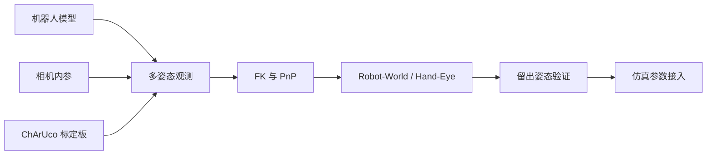
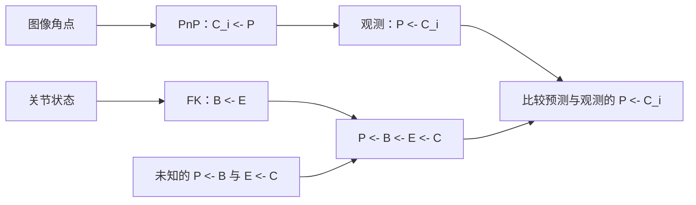
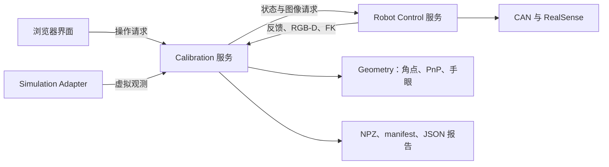

RoboTwin 可以使用 Piper-X 模型模拟机械臂运动，但仿真中的机器人和相机位置不一定与真实工作台一致。例如，两台机器人基座的间距可能不同，腕部相机的安装角度也可能有偏差。即使机器人处于相同的关节姿态，相机看到的物体位置也会不同。

要让仿真更接近实际安装，需要测量机器人与相机之间的位置和朝向关系。这就是工作站几何校准要解决的问题。

这里的工作站由两台 Piper-X、两台腕部 D435 和一台固定第三视角 D435 组成。我们将一张 ChArUco 标定板固定在桌面上，让左右臂分别从多个姿态拍摄它，再结合实际关节反馈估计基座位置与相机安装关系。检查结果后，就可以将这些关系转换到 RoboTwin 使用的场景坐标系中。

<Callout title="关于示例数据">
案例使用 RoboTwin/SAPIEN 渲染的 RGB 图像和从仿真机器人读取的关节反馈，由校准程序计算结果并在操作界面中离线回放。整个实验没有连接真实 Piper-X 或 D435。因此，这些结果用于说明仿真中的校准方法，不能证明物理工作站的精度或运动安全性。
</Callout>

## 1. 校准目标与参数来源

### 已知模型与安装参数

Piper-X 的官方模型已经描述了连杆与关节。结合当前关节角，可以计算末端相对于机器人基座的位置和朝向。但模型不知道基座实际安装在桌面的什么位置，也不知道额外安装的腕部相机相对于末端偏了多远、转了多少。这些关系需要根据工作站的实际安装情况确定。

相机也有两类几何参数。**内参** 描述相机怎样成像，包括焦距、图像主点和镜头畸变；**外参** 描述相机相对于机器人末端或标定板等参考系的位置与朝向。本项目从当前相机流读取内参，通过图像和关节反馈估计安装外参。

下表列出可直接取得的信息和需要估计的关系。后续章节会分别解释正向运动学（FK）、标定板，以及通过图像计算位姿的 PnP 方法。

| 所需数据 | 从哪里取得 | 在程序中做什么 |
| --- | --- | --- |
| 连杆、关节轴、限位和模型尺寸 | 官方 URDF/Xacro、mesh 与控制接口 | 从关节角计算末端位置，建立仿真机器人 |
| 当前关节角 | 机器人反馈；仿真中读取关节状态 | 与每次图像观测对应 |
| 相机内参、畸变、分辨率 | D435 SDK 当前彩色流 | 将棋盘上的已知点与图像像素对应 |
| 腕部相机相对末端的位置和方向 | 多姿态图像与末端位姿联合求解 | 手眼外参 |
| 两个底座相对同一张标定板的位置和方向 | 每臂独立求解 | 建立双臂的公共参考 |
| 固定相机相对标定板的位置和方向 | 固定相机拍摄标定板，进行 PnP 求解 | 固定相机外参 |

这些信息按下面的顺序参与校准：



### 完整安装变换与手工测量的局限

尺子量到的相机外壳中心，不一定是 RGB 相机的光学中心。两个底座的中心距离相同，也可能存在前后错位、相对转角和高度差。只填一个“间距”和一个“俯仰角”，表达不了这些偏差。

因此，需要同时估计位置和朝向，合起来称为 **位姿**。刚体变换用三个平移量和三个旋转自由度描述位姿，数学上属于 SE(3)，即三维空间刚体变换组成的群。

以固定板为公共参考，校准要得到两个基座的位姿、两台腕部相机相对于各自末端的安装关系，以及固定相机的位姿。基座间距、相机高度便于人工检查，但接入仿真时需要使用完整变换。

程序会保存这些变换、观测记录和质量报告。将结果应用到 RoboTwin 任务是另一个步骤；导出结果不会自动改写任务环境文件。

## 2. 机器人模型与坐标系

### 机器人模型与运动学验证

在使用相机图像进行标定之前，先确认机器人模型能正确计算末端位姿。根据关节角和连杆、关节的几何关系计算末端位姿，这个过程称为 **正向运动学（Forward Kinematics，FK）**。手眼标定会使用每次拍照时的 FK 结果；如果关节顺序、旋转方向或工具偏移有误，即使标定板拍得很清楚，最终相机安装关系也可能算错。

Piper-X 的 URDF 描述了连杆如何连接、关节如何运动，可以从[松灵 AgileX 官方 agx_arm_urdf 仓库](https://github.com/agilexrobotics/agx_arm_urdf)取得。已有来源记录对应以下文件：

```text title="Piper-X 官方模型的来源线索"
piper_x/urdf/piper_x_description.urdf
piper_x/urdf/piper_x_with_gripper_description.xacro
```

mesh 文件提供外观和碰撞形状；Xacro 用变量和宏组织机器人描述，通常需要展开后才能交给通用 URDF 加载器。导入 SAPIEN 时，还可能需要解析 ROS 资源路径、处理夹爪联动，并加入相机节点。

核验模型时，选几组已知的静止姿态，与控制器反馈比较。先确认关节顺序、正方向、零位和长度单位，再使用同一个末端参考比较位置与朝向。外形相同的模型仍可能采用不同的关节约定。

独立校准场景使用安装脚本准备的固定版本 Piper-X 资源，只加载机器人、桌面、光照和相机，不加载任务物体或策略代码。[RoboTwin-PiperX](https://github.com/Max-Lii/RoboTwin-PiperX) 展示了适配后模型在完整任务环境中的组织方式。迁移到其他机器人时，应从厂商取得对应型号的模型，并检查资源和许可证。

### 末端参考系、TCP 与相机光学坐标系

<Figure src="/images/piper_coordinate_frames_figure.webp" alt="Piper-X 整机与腕部的坐标系标注，展示底座、link6、工具中心和光学坐标系" caption="已有模型标注图：B 是底座，E 在本图中指 link6，TCP 是工具参考点，C 是 OpenCV 光学坐标系。图用于解释位置关系；图示相机安装值不能代替你的真实手眼结果。" />

描述位姿时，除了参考点，还需要指定坐标轴方向。夹爪附近常用的几个坐标系各有用途：

<div className="reference-table">

| 参考系或参考点 | 符号 | 含义与约定 |
| --- | --- | --- |
| 机器人底座 | B | 机器人自身的参考系，通常对应 `base_link`。FK 计算的末端位姿以它为参考。 |
| 末端参考系 | E | 采集时 FK 实际输出的参考系。图中以 `link6` 为例，但采集接口可能已经叠加工具变换。 |
| 工具中心点 | TCP | 操作任务选定的参考点，例如夹爪中间或指尖前方的某个点。对应坐标系可通过偏移定义，不一定需要单独的 URDF link。 |
| 相机光学系 | C | 图像投影使用的坐标系。OpenCV 约定 X 向图像右，Y 向图像下，Z 沿视线向前。 |

</div>

接口中的末端通常缩写为 **EE**。它报告的位姿可能已经包含工具中心点（**TCP**）偏移。将它与相机标定结果组合前，必须确认它对应哪个参考系；字段名叫 `ee`，并不意味着它就是原始 `link6`。

<details>
<summary>当前机器人接口返回的末端参考系</summary>

例如当前真机代码在 `robotcontrol/piper_x.py` 的 `read_kinematics()` 中调用 SDK 的 `fk()`，将结果保存为 `left_T_base_ee` 和 `right_T_base_ee`。独立仿真 `sim/robotwin/adapter.py` 的 `Robot.ee_pose()` 则保留 RoboTwin 的末端参考计算，包括配置中的旋转和夹爪偏移。**手眼结果始终相对于采集时实际提供的 E 定义。** 接入其他机器人或换末端接口时，要先把这个定义对齐。

</details>

相机没有外壳 mesh 并不妨碍求解：我们要定位的是光学坐标系。但相机和支架确实占有空间，检查实际运动路径时仍需考虑它们。

### 理解位姿矩阵

同一个物理点，从基座、末端或相机量起，会得到不同的坐标。坐标变换用于在这些描述之间转换。全文用 ${}^{A}T_B$ 表示“把 B 中的坐标变成 A 中的坐标”。代码中的 `T_world_base` 也按目标参考系在前的顺序命名，但其中 `world` 具体指哪个参考系仍需确认：

$$
{}^A T_B=\begin{bmatrix}R&t\\0&1\end{bmatrix},\qquad
\begin{bmatrix}p_A\\1\end{bmatrix}
={}^A T_B\begin{bmatrix}p_B\\1\end{bmatrix}.
$$

其中 $R$ 是 3×3 旋转矩阵，$t$ 是 B 原点在 A 中的位置。下面是一个教学例子：B 相对 A 绕 Z 轴转 90°，原点位于 A 的 `(0.3, 0.1, 0)` 米。B 的 X 轴上 0.1 米处那个点，在 A 中变成哪里？

```python title="可独立运行的坐标变换例子" runnable
import numpy as np

T_A_B = np.array([
    [0, -1, 0, 0.3],
    [1,  0, 0, 0.1],
    [0,  0, 1, 0.0],
    [0,  0, 0, 1.0],
], dtype=float)
p_B = np.array([0.1, 0.0, 0.0, 1.0])
p_A = T_A_B @ p_B
print(p_A[:3])  # [0.3 0.2 0. ]，单位：米
```

串联坐标系时，中间字母应当接得上；反过来则取逆：

$$
{}^A T_C={}^A T_B\,{}^B T_C,\qquad
{}^B T_A=({}^A T_B)^{-1}
=\begin{bmatrix}R^\top&-R^\top t\\0&1\end{bmatrix}.
$$

后面看到较长的变换链时，可以用这个规则逐项核对。不要只对平移取负号来代替矩阵求逆：旋转后，平移所处的方向也变了。

### FK 链与末端定义核验

FK 将同样的矩阵组合规则用于整条机械臂。URDF 中每个关节通过固定偏移和随关节角变化的运动连接前后连杆。按模型顺序代入实际关节角后，依次相乘得到：

$$
{}^B T_E(q) = {}^B T_{L_1}(q_1)\cdots{}^{L_5}T_{L_6}(q_6)\,{}^{L_6}T_E.
$$

核验时选取若干静止姿态，在确认单位和参考点一致后比较模型与控制接口的完整平移及旋转。若接口报告 TCP，应先去掉或显式保留对应工具变换。确定这一点后，后文所有 ${}^{B}T_E$ 和 ${}^{E}T_C$ 才能使用同一个 E；几何上相近的参考点不能在计算中互换。

## 3. ChArUco 标定板与公共参考系

### 共同参考

FK 给出末端相对于基座的位姿，相机则拍到工作区的图像。要将这两种信息联系起来，需要一个几何尺寸已知、特征能够在图像中识别的参考物体。

**ChArUco 标定板** 由棋盘格和带编号的 ArUco 标记组成。借助标记，程序可以识别棋盘内角点，即使图像只拍到部分标定板，也能根据角点 ID 查出它在板上的已知位置。这样，板上的实际位置就与图像中的像素位置对应起来。

将同一块板固定在桌面上，左右臂分别拍摄，就能让两组观测使用同一个几何参考：

<Figure src="/images/piper_shared_world_and_charuco_65_35.webp" alt="右臂采集阶段的双臂工作台，以及同一张固定的 ChArUco 标定板" caption="左图是右臂采集阶段的一个实际仿真姿态，另一臂处于非采集状态。左右臂分别独立采集；两组数据通过始终不动的标定板建立关系。图中 W 是便于说明的中心原点、Z 向上世界系；这是坐标关系示意，不作为下文归档实验的采集帧。" />

不必事先精确测量板在桌面上的位置。板的实际尺寸确定了角点相对于板的位置，程序再估计每个基座相对于板的关系。板必须平整、刚性固定，并在先采一臂、停靠、再采另一臂的整个过程中保持不动。如果两次采集之间移动了板，两个基座的估计就不再对应同一次放置。

这里不要求左右相机在每个采集姿态下同时看到完整棋盘。固定相机提供另一组独立观测；观察整个场景的 debug 相机只是辅助视角，不能把它当作真实第三台 D435。

### 图案与编号

板模型用米记录角点的实际位置，检测结果用像素记录角点在图像中的位置。ID 负责连接这两组点，并不测量纸上的实际尺寸，因此模型参数必须与打印结果一致。

本项目名为 `BOARD_002` 的标定板采用以下参数：

| 项目 | 数值 | 含义 |
| --- | --- | --- |
| 字典 | `DICT_4X4_50` | 从同一组编码中识别标记 |
| 棋盘格数 | 5×7 | 方格数量，不是内角点数量 |
| 方格边长 | 35 mm | 为三维点提供实际长度尺度 |
| ArUco 标记边长 | 26.25 mm | 标记外边缘的设计尺寸 |
| 棋盘图案尺寸 | 175×245 mm | 5×35 与 7×35 |
| 内角点上限 | 24 | `(5−1)×(7−1)` |
| 页面外圈标记 | ID 40–43 | 辅助页面定位、方向及打印变形检查 |

外圈 ID 40–43 不是当前手眼 PnP 使用的棋盘内角点。`ALIGN X` 也是放置提示，不是拿来参与 PnP 的额外角点。几种标记各自有用途，不要把所有黑白图形都送进同一组物点。

```python title="建立与实际打印一致的 ChArUco 几何" runnable
import cv2

dictionary = cv2.aruco.getPredefinedDictionary(cv2.aruco.DICT_4X4_50)
board = cv2.aruco.CharucoBoard((5, 7), 0.035, 0.02625, dictionary)
points = board.getChessboardCorners()
print(points.shape)  # (24, 3)
print(points[0])     # 约 [0.035, 0.035, 0.0] 米
```

在本版本中，`getChessboardCorners()` 返回棋盘平面上、按 ID 索引的内角点。检测到 `ids` 后，用 `points[ids]` 就能取得对应三维位置，不需要手工给图像角点排序。

### 生成与打印

标定板 PDF、PNG 和几何参数文件保存在 `assets/targets/`。需要新副本时，运行下面的生成器，它会同时保存打印用 PDF 和记录参数的 JSON。只安装基础环境时所需的额外依赖见[安装附录](#installation)。

```bash title="生成 BOARD_002 的新副本，保留仓库原文件"
python -m sim.generate_a4_charuco_pdf \
  --target-id BOARD_002 --metric-fiducials \
  --output-pdf /tmp/piperx-board/BOARD_002.pdf \
  --output-manifest /tmp/piperx-board/BOARD_002.json
```

打印选择 A4、实际大小或 100%，关闭“适应纸张”。打印后测量多个方格跨度，例如连续四格应为 140 mm；横纵方向都检查，比只量一个小格更容易发现缩放和各向异性变形。

PnP 把“35 mm”当作已知事实。如果纸上实际只有 33.25 mm，程序仍按 35 mm 求解，距离估计就会受到同样量级的尺度影响。仅仅识别出四个外圈标记不能证明绝对尺度正确，因为打印机会把它们与棋盘一起缩放。可靠的尺度要来自独立测量，或可靠识别的实际纸张边界。

当前 UI 提供照片验证，也提供操作员确认卡尺测量的入口。后者记录的是“你已经确认当前设计尺寸正确”，不会自动把测量值写回新的格子尺寸。测量不一致时应修正打印或使用与实际尺寸一致的新参数文件。

### 棋盘系与世界系

将板的尺寸写成坐标，还需要指定原点和坐标轴。OpenCV 将原点放在棋盘外角，X、Y 沿图案排列，Z 按右手关系确定。我们将这个棋盘坐标系记作 **P**，PnP 使用的三维角点都在 P 中表示。

配置工作站时，另一种原点可能更方便，例如上图采用的图案中心原点、Z 向上的坐标系。我们将人为选定的工作站参考系记作 **W**。P 和 W 描述的是同一批物体，但量起的位置和方向不同，坐标数值不能直接混用。

当前原始导出字段虽然叫 `T_world_base`，其中的 `world` 实际指 **P**。读取或显示这个字段，不会将结果自动转换成 W。

如果你希望采用中心原点、Z 朝上的 W，应显式计算 ${}^{W}T_P$。对于本文这张仿真纹理，已经核对图案方向：P 的 X 与 W 的 X 同向，P 的 Y 与 W 的 Y 反向，因此 Z 也反向。棋盘宽 0.175 m、高 0.245 m，对应：

$$
{}^W T_P=
\begin{bmatrix}
1&0&0&-0.0875\\
0&-1&0&0.1225\\
0&0&-1&0\\
0&0&0&1
\end{bmatrix}.
$$

这个矩阵只适用于上述图案朝向与 W 定义。若你选择另一种板方向，应根据实际放置重新定义。页面中心也不等于棋盘中心：本页棋盘左边距是 8 mm，中心相对纸张中心偏了 9.5 mm，不能直接把纸张 actor 的原点当棋盘中心。

```python title="将已有棋盘系结果表达成选定的工作台世界系（节选）" excerpt
# T_P_base、T_P_camera 来自校准；T_W_P 来自明确的坐标系定义。
T_W_base = T_W_P @ T_P_base
T_W_camera = T_W_P @ T_P_camera
# 相机相对末端的安装关系 T_ee_camera 不需要跟随世界原点改变。
```

RoboTwin 还有由仿真环境定义的场景系 **S**。校准输出使用 P，工作站可以选用 W，而仿真物体放置在 S 中。第 9 章会说明如何确定板在 S 中的位置，并据此转换校准结果。

<a id="pose-design" />

## 4. 采集姿态设计与数据记录

找到能清楚拍到标定板的姿态后，还需要从其他方向继续拍摄。单张图像能确定板相对于当前相机的位置和朝向，但在基座位姿也未知时，无法单独确定相机相对于末端的安装关系。

机械臂运动时，末端和相机一起移动，板和基座保持固定。板在图像中的位置与角度随之变化，而相机相对于末端的安装关系始终不变。利用多个姿态的观测，程序可以寻找一组能够同时解释这些变化的固定安装变换。

### 可见性与旋转多样性

<FigureGrid>
<Figure src="/images/home_right_camera.webp" alt="右腕相机 Home 状态朝向前方，无法观察桌面标定板" caption="初始 Home 视图朝前，桌面板不在有效视野内。没有把机械臂转到采集方向，检测器再好也得不到观测。" />
<Figure src="/images/right_05_right_wrist.webp" alt="right_05 下右腕可见固定桌面棋盘" caption="进入 right_05 后，板出现在腕相机中。还要检查角点数、覆盖范围、边缘距离和重投影误差。" />
</FigureGrid>

先让相机看清标定板，再在工作站的安全范围内改变末端位置和朝向。除了调整远近，还应让末端绕不同方向转动，帮助求解器区分基座位姿和相机安装关系。大量拍摄几乎相同的画面，增加的信息很少。

<Figure src="/images/board002_pose_diversity.webp" alt="四个右臂实际采集姿态与各自腕图，比较末端方向、板的倾角和图像覆盖变化" caption="同一批次的 right_00、right_05、right_10、right_15。每个单元左为 observer 的统一裁剪，右为同一状态的完整腕图。注意末端方向和板在图中的变化；range 是光学中心到 P 原点的距离，tilt 是板法向与光轴的夹角。" />

四个视角都能看到板，但板的倾角和图像位置发生了变化。设计采集姿态时应保留这类差异；后面还要检查估计的安装关系能否预测没有参与拟合的姿态。

### 仿真场景与观测来源

图像和结果来自 2026-10-24 记录的 **`BOARD_002_20261024_tutorial30_default`**。每臂尝试 30 个姿态，图像分辨率为 640×480。[全部观测](repo:/doc/experiments/BOARD_002_20261024_tutorial30_default/observations.json)与[结果报告](repo:/doc/experiments/BOARD_002_20261024_tutorial30_default/result.json)一起归档，渲染参数和来源校验信息见[附录 B](#reference)。

场景只加载双臂 URDF、桌面、三台相机和真实尺寸的板纹理，不加载任务物体。板保持固定，内参来自仿真相机，机器人提供实际仿真反馈与 FK：

<Figure src="/images/right_00_observer.webp" alt="实际 SAPIEN 工作站，固定板、左臂停放、右臂处于 right_00" caption="本轮 right_00 的完整 observer 视图，用于说明工作站布置；它不是固定第三相机的标定图像。" />

仿真还能记录已知的安装变换，将它们单独保存在 `truth.json` 中。求解器只使用图像 PnP 和实际 FK，校准结束后才与这些已知变换比较。板的坐标轴方向在采集前就已确定。

实验沿用每臂 30 个目标姿态的关节库，在每个姿态重新读取图像和仿真反馈。目标角度与实际反馈可能不同，`right_05` 就存在这种差异，因此 FK 必须使用实际状态。重新生成姿态库时，扫描器如何筛选候选见[附录 B](#reference)。

### 逐臂顺序采集

实际顺序是左臂 30 个姿态、左臂停放、右臂 30 个姿态。每次只有当前臂的腕相机负责该臂的手眼观测，另一臂不同时采集自己的姿态序列。固定相机独立观察板；它与用于说明机器人的 observer 视角是两台不同的虚拟相机。

### 稳定采集与观测配对

每张图像都需要对应拍摄时刻的机器人位姿。如果机械臂还在运动，拍摄前后读到的反馈就可能描述另一个姿态；即使角点检测准确，这种配对也会使手眼结果出错。

因此，硬件采集需要先等待机器人停止运动，再拍摄图像。`calibration/capture.py` 检查关节和夹爪是否接近目标，以及关节速度是否足够小，并要求所有条件持续满足设定时间：

```python title="采集稳定判定的核心逻辑（节选）" excerpt
stationary = (
    joint_error <= policy.joint_tolerance_rad
    and joint_velocity <= policy.velocity_tolerance_rad_s
    and gripper_error <= policy.gripper_tolerance
)
# stationary 连续成立 stable_for_s 后，才进入图像采集。
```

一次逻辑姿态会分别采集夹爪闭合和张开状态的图像，默认每种状态 3 帧。这样既记录夹爪状态，也给遮挡和偶发无效帧留出冗余。手眼观测的几何配对依据实际反馈；不要拿发出的目标角度替代实际到达的角度。

采集文件包括无损 `.npz`、帧号、时间戳、相机参数和图像前后机器人状态。JPEG 预览只用于查看，不是正式求解唯一的数据来源。原始记录提交到 `manifest.jsonl`，便于回溯哪个姿态、哪帧图像被使用。

这些检查用于硬件采集。示例记录只有 RGB 和仿真反馈，没有深度数据或物理时序测试；经过有限仿真步数，不能证明真机会在拍摄时保持静止并完成同步。

## 5. PnP 与 Robot-World/Hand-Eye 求解

### 图像与 PnP

相机拍摄到标定板后，程序首先检测图像中可见的 ChArUco 棋盘内角点。每个成功检测的角点都有一个对应的 ID，程序可以根据这个编号，在预先定义的棋盘模型中找到该角点的三维坐标。

这样，我们就同时知道了一个角点在标定板上的实际位置，以及它在相机图像中的像素位置。将多个角点的这两组位置对应起来，就得到了 PnP 求解所需的二维—三维点对。其中，角点的三维坐标统一使用前面定义的棋盘坐标系 $P$。这里的 ID 是 ChArUco 内角点的编号，用来查找点对；它不是印在每个角点旁边的文字，也不等同于 ArUco marker ID。

**PnP（Perspective-n-Point）** 可以根据这些对应点和相机内参，估计标定板相对于相机的位置和朝向。理解这个计算，可以先反过来想：如果已经知道板的位姿，它的角点应该落在图像的哪里？

暂时忽略镜头畸变，先将棋盘点 $p_P$ 转换到光学系 C，再通过相机内参矩阵 $K$ 投影：

$$
\lambda\begin{bmatrix}u\\v\\1\end{bmatrix}
=K\left(R_{CP}p_P+t_{CP}\right),\qquad
K=\begin{bmatrix}f_x&s&c_x\\0&f_y&c_y\\0&0&1\end{bmatrix}.
$$

$(u,v)$ 是像素位置，$f_x,f_y$ 是以像素为单位的焦距，主点 $(c_x,c_y)$ 给出这个相机模型中光轴与成像平面的交点。比例因子 $\lambda$ 对应这个点沿光学 Z 轴的深度。旋转矩阵 $R_{CP}$ 将棋盘系 $P$ 的方向变换到相机光学系 $C$，平移向量 $t_{CP}$ 表示棋盘原点在 $C$ 中的位置。$s$ 是像素坐标轴的倾斜项，常见 RGB 相机中为零。实际投影还要考虑镜头畸变，下面用 $D$ 表示畸变参数。PnP 要寻找的旋转和平移，应使这些投影点尽量接近检测到的角点。

程序从当前相机流读取内参与畸变参数，并保证它们与角点检测使用的分辨率和图像处理方式一致。[D435 内参读取](#camera-intrinsics)说明 SDK 字段及硬件读取方法。畸变系数必须符合 OpenCV 接口所用的模型，正向与逆向 Brown 模型不能直接混用。

下面的节选把这条投影关系落实到代码：`ids` 负责配对，`object_points` 提供以米为单位的板上位置，`corners` 提供观测像素。`frame` 是已解码的 `CalibrationFrame`，`target` 是从参数文件加载的 `CharucoTargetSpec`。

```python title="从角点对应关系求 T_camera_target（节选）" excerpt
board = target.board()
corners, ids, _, _ = cv2.aruco.CharucoDetector(board).detectBoard(frame.rgb)
object_points = board.getChessboardCorners()[ids.reshape(-1)].astype(np.float64)
ok, rvec, tvec = cv2.solvePnP(
    object_points, corners,
    frame.color_intrinsics, frame.distortion,
    flags=cv2.SOLVEPNP_ITERATIVE,
)
R_camera_target, _ = cv2.Rodrigues(rvec)
```

输出的 ${}^{C}T_P$ 是板相对于相机的位姿，将棋盘坐标转换到 C；取逆才得到相机在 P 中的位姿。完整的 `estimate_camera_target()` 还会检查角点数量和 PnP 是否成功、构造矩阵，并计算图像与深度诊断指标。

### 角点质量与重投影误差

图像不必拍到整张板，但需要足够多、分布范围合适的可识别角点。如果角点挤在很小的区域，或紧贴图像边缘，检测位置的微小变化就可能使估计位姿明显改变。

检查拟合效果时，用估计位姿将已知板点重新投影到图像，再测量投影位置与检测位置之间的距离，这就是 **重投影误差**。将各点的像素距离平方后取平均，再开平方，得到均方根（RMS）：

$$
e_{\mathrm{px}}=\sqrt{\frac{1}{N}\sum_{j=1}^{N}
\left\|\pi(K,D,{}^CT_P,p_{P,j})-u_j\right\|_2^2}.
$$

其中投影函数 $\pi$ 使用相机内参矩阵 $K$、畸变参数 $D$ 和板位姿，$u_j$ 是第 $j$ 个检测角点，$N$ 是角点数。误差较大时，应检查角点检测、内参和图像处理是否正确。这个计算没有使用机器人 FK，因此还不能判断相机安装关系是否正确。打印图案整体缩放时，也可能得到很小的像素误差，所以仍需独立核对打印尺寸。

在实际采集时，需要确保每张用于标定的图像都包含足够多、分布合理的有效角点。即使图像中能够识别出标定板，如果角点数量太少，或者都集中在很小的区域，计算出的位姿也可能不够稳定。

因此，当前程序要求一帧图像至少检测到 8 个有效 ChArUco 角点。同时，为了避免角点过于集中，还会计算这些角点在图像中形成的凸包面积，并要求其至少占整张图像面积的 0.5%（对应程序阈值 0.005）。凸包是包围这些点的最小凸区域；它的面积越大，说明角点覆盖的图像区域越宽。

除此之外，检测到的角点还应与图像边缘保持至少 6 px 的距离，PnP 的重投影均方根误差不能超过 2 px。只有满足这些条件的观测才会参与后续手眼求解。几何函数虽然至少 4 点就能运行，但这弱于采集质量要求；初始放板阶段另有更严格的可见性检查。这些数值是当前实验使用的质量筛选条件，不是所有相机和标定板都必须采用的统一标准。

### 实际观测：机器人状态与图像配对

对于每个通过质量检查的采集姿态，我们可以得到两项空间位姿。一项来自机器人：根据拍摄时刻的实际关节角，通过 FK 计算末端相对于基座的位姿 ${}^{B}T_E$。另一项来自相机：利用图像中的 ChArUco 角点和 PnP，估计标定板相对于相机的位姿 ${}^{C}T_P$。将这两项结果与对应图像一起保存，就得到后续手眼标定需要的一组观测。这里使用的是实际反馈，不是发给机器人的目标关节角。

以右臂第 6 个姿态 `right_05` 为例，下图左侧保留原始腕图，右侧只放大角点区域。蓝色标签是 ChArUco 内角点 ID，既标识二维检测点，也决定应从板模型中读取哪个三维点。例如 ID 0 对应 P 中约 `(0.035, 0.035, 0)` 米处的内角点；它不是图案中某个 ArUco 方块的编号。

<Figure src="/images/board002_right05_correspondences.webp" alt="right_05 原始腕图与放大的 19 个真实 ChArUco 内角点 ID，对应板上已知三维点" caption="right_05：蓝框标出右侧放大的区域。19 个检测角点的 ID 为 0–15、17、18、19；每个 ID 将一个像素位置与一个已知三维板点配对。" />

这 19 组点对给出重投影 RMS **0.419 px**，说明估计的板位姿较好地拟合了当前图像。角点凸包覆盖约 **7.40%**，最小边缘距离 **43.73 px**，满足图像质量要求。但这些检查还不能单独证明最终手眼标定的精度。

FK 则给出 E 原点在基座 B 中约为 `(0.054946, 0.023734, 0.270451)` 米；PnP 给出 P 原点在光学系 C 中约为 `(-0.217056, -0.042843, 0.504489)` 米。两组三维位置分别属于不同参考系，不能直接相减得到相机安装偏移。完整旋转和平移保留在下面的数值记录中。

<details className="observation-data">
<summary>实际数值：right_05 的关节反馈、FK 与 PnP 矩阵</summary>

数据取自[完整单条记录](repo:/doc/experiments/BOARD_002_20261024_tutorial30_default/right_05.json)，它是全序列第 36 条（零基索引 35）。关节角为弧度；两个矩阵的平移均为米。FK 的 E 是本实验 `Robot.ee_pose()` 的实际输出参考，不是直接取图示 link6。

```text title="right_05 实际关节反馈，rad"
[0.642655, 0.139684, -0.507338, 1.076987, 0.300936, 0.431129]
```

${}^{B}T_E$ 将 E 中坐标变到 B：

```text title="right_05 的实际 FK：T_B_E"
[[ 0.798887, -0.149863,  0.582513,  0.054946],
 [ 0.227827,  0.971696, -0.062464,  0.023734],
 [-0.556664,  0.182614,  0.810418,  0.270451],
 [ 0.000000,  0.000000,  0.000000,  1.000000]]
```

${}^{C}T_P$ 将 P 中坐标变到 C，来自 `estimate_camera_target()` 的 19 点 PnP。本仿真相机畸变为零；真实 D435 要使用当前流的实际畸变模型。

```text title="right_05 的 PnP 输出：T_C_P"
[[ 0.973822, -0.114137,  0.196582, -0.217056],
 [-0.014618,  0.831570,  0.555228, -0.042843],
 [-0.226843, -0.543567,  0.808132,  0.504489],
 [ 0.000000,  0.000000,  0.000000,  1.000000]]
```

</details>

程序将 $({}^{B}T_E,{}^{C}T_P)$ 与图像校验值、内参、角点 ID 和质量指标一起保存，作为多姿态求解的一条观测。下一步是寻找能够解释全部有效观测的固定基座位姿与相机安装关系。

### 多姿态约束

这两项测量使用不同的坐标系，不能将位置直接相减来求相机安装偏移。真正要估计的是两个固定关系：

- ${}^{P}T_B$：机器人基座相对于标定板的位姿。
- ${}^{E}T_C$：相机相对于末端参考系的位姿。

基座固定在工作台上，相机固定在末端上。机械臂运动时，这两个关系都不应改变，因此同一组变换必须符合每个采集姿态 $i$ 的测量：

1. 关节反馈与正运动学给出 ${}^{B}T_{E,i}$，即末端在底座中的位姿。
2. 图像与 PnP 给出 ${}^{C_i}T_P$，取逆得到相机在固定棋盘中的位姿。

根据机械臂运动时的观测，同时估计固定基座位姿和相机安装变换，就是 **Robot-World/Hand-Eye Calibration**。沿相机、末端、基座依次转换到 P，得到的相机位姿应与 PnP 取逆后的结果相同：

$$
\boxed{{}^{P}T_B\;{}^{B}T_{E,i}\;{}^{E}T_C
=({}^{C_i}T_P)^{-1}}.
$$

同一个相机位姿可以沿两条路径得到：



一条路径根据图像估计相机位姿，另一条根据机器人状态和两个安装变换计算相机位姿。后面会用未参与拟合的观测比较两条路径。单帧 PnP 误差较小，只说明图像估计能够拟合它自己的角点。

只有一个姿态时，不同的基座位姿与相机安装组合可能得到同一个相机位姿。增加姿态后，每种候选组合还必须符合新的测量；绕不同方向转动，可以帮助区分那些在单个姿态下无法分辨的组合。

也可以从两次拍摄之间的运动来理解。令 $F_i={}^B T_{E_i}$、$Y_i=({}^{C_i}T_P)^{-1}$、$X={}^E T_C$。比较姿态 i 和 j 的方程时，基座变换在两式中相同，可以消去，得到常见的手眼方程 $AX=XB$：


$$
A_{ij}X=XB_{ij},\qquad
A_{ij}=F_i^{-1}F_j,\qquad B_{ij}=Y_i^{-1}Y_j.
$$


其中 A 描述末端的相对运动，B 描述相机的相对运动，X 是联系二者的安装变换。如果所有动作都只是平移，或旋转几乎都绕同一轴进行，某些安装参数就可能无法确定，这样的姿态组合称为 **退化配置**。绕不同轴转动有助于避免这类问题。求出 X 后，再代入原方程就能确定 ${}^{P}T_B$。

本项目使用 OpenCV 的 Robot-World/Hand-Eye 接口联合求解这两项固定变换。SHAH 和 LI 是该接口提供的两种方法；主求解使用 SHAH，验证阶段还会用 LI 进行比较。OpenCV 接口所需的机器人输入方向与存储的 FK 相反，因此先取逆；它返回 ${}^{P}T_B$ 和 ${}^{C}T_E$，后者再取逆保存为 ${}^{E}T_C$：

```python title="求解器的输入、输出方向（对应 geometry.py）（节选）" excerpt
# observations 每项含 camera_target = T_C_P、base_ee = T_B_E。
world_to_camera = [item.camera_target for item in observations]
base_to_gripper = [np.linalg.inv(item.base_ee) for item in observations]

r_P_B, t_P_B, r_C_E, t_C_E = cv2.calibrateRobotWorldHandEye(
    [T[:3, :3] for T in world_to_camera],
    [T[:3, 3:4] for T in world_to_camera],
    [T[:3, :3] for T in base_to_gripper],
    [T[:3, 3:4] for T in base_to_gripper],
    method=cv2.CALIB_ROBOT_WORLD_HAND_EYE_SHAH,
)
# 最后将返回的 T_C_E 取逆，保存为 T_E_C。
```

左右臂分别执行上述求解，各自得到一个基座和一个相机安装变换。因为两次使用的是同一个固定 P，两个基座便可以直接相连：

$$
{}^{B_L}T_{B_R}=({}^{P}T_{B_L})^{-1}\,{}^{P}T_{B_R}.
$$

只要两臂使用同一张固定板，这个相对关系不依赖你将公共世界原点选在棋盘角落还是中心。

固定第三视角相机不随机械臂运动，只需要确定它相对于同一块板的位姿，因此不需要腕部手眼运动序列。检测标定板、进行 PnP，再取逆即可得到：

$$
{}^P T_{C_3}=({}^{C_3}T_P)^{-1}.
$$

一般流程从合格固定相机观测中选择重投影误差较小的一帧；本文记录采用 `left_00` 对应帧，没有对全部第三相机帧联合优化。用于说明机器人姿态的 observer 不参与这个求解。

以下示例从归档有效观测重算右臂全量解，可独立运行；不会使用 `truth.json`。

```python title="从这轮有效观测重新求解右臂" runnable
import json
import numpy as np
from pathlib import Path
from piperx_calibration.calibration.geometry import (
    HandEyeObservation, solve_robot_world_hand_eye,
)
run = Path("doc/experiments/BOARD_002_20261024_tutorial30_default")
rows = json.loads((run / "observations.json").read_text())
observations = [
    HandEyeObservation(np.array(r["T_C_P"]), np.array(r["T_B_E"]))
    for r in rows if r["arm"] == "right" and r["quality"]["accepted"]
]
solution = solve_robot_world_hand_eye(observations)
# T_world_base 在这里是 T_P_B；T_ee_camera 是 T_E_C。
```

## 6. 校准质量评估与仿真结果

### 校准结果的可靠性验证

多姿态求解给出了基座和相机的安装关系，但仍需要检查这些结果是否可靠，尤其是它们能否解释没有参与求解的姿态。

完成不同姿态下的图像采集后，我们可以结合每次拍照时的机器人末端位姿和标定板观测，估计机器人基座及腕部相机的安装外参。不过，能够求出一组数值，并不代表这些参数就一定准确。如果采集时机械臂始终保持相近的观察方向，不同姿态提供的几何信息就会比较有限。求解器可能找到一组与现有观测较为一致的参数，但当相机从其他角度观察标定板时，这组参数的预测误差可能明显增大。

为了检查这种情况，可以提前保留一部分采集姿态，不让它们参与外参求解。使用其余姿态完成标定后，再根据保留姿态的实际关节角计算 FK，并结合求出的安装外参，预测相机在该姿态下应该处于什么位置。最后，将这个预测结果与该姿态下通过图像独立估计的相机位姿进行比较。这些专门保留下来用于验证的观测，称为 **留出姿态（Held-out poses）**。

这样可以检查结果能否解释拟合数据之外的姿态。在仿真中，还可以将结果与创建场景时设置的安装变换比较，这些已知变换称为 **仿真真值（Ground Truth）**。求解器不使用真值，只在校准结束后用它评价结果。

报告中各项检查回答不同的问题。其中 SHAH 和 LI 是两种求解方法；bootstrap 重采样则反复选取不同的观测样本求解，检查结果对姿态选择是否敏感。

| 报告信息 | 它在检查什么 | 该怎样处理 |
| --- | --- | --- |
| accepted / rejected | 哪些姿态实际进入求解 | 看被拒绝的具体图像与原因，不靠数量猜测 |
| 重投影误差 | 求出的板位姿能否解释图像角点 | 检查模糊、角点、内参、畸变和图像缩放 |
| 留出姿态误差 | 安装关系能否预测未参与拟合的姿态 | 检查末端参考、姿态变化和固定安装假设 |
| SHAH / LI 差异 | 换一种求解方法后结果是否接近 | 大差异提示样本或模型问题 |
| bootstrap 波动 | 改变样本组成后结果是否稳定 | 判断是否过度依赖少量姿态 |
| 深度一致性 | RGB/PnP 的距离与深度是否相符 | 同时检查深度质量、尺度和相机对齐 |

接受结果前，应查看诊断信息和被拒绝的观测。指标缺失表示没有执行相应检查，不表示误差为零。发现不一致时，先保留数据、定位原因，再决定补采什么。[附录 B](#reference)说明程序使用的最少姿态数、跳过验证的条件和警告字段。

### 留出误差与不确定性

验证时必须将拟合观测与留出观测分开，否则某条观测既参与确定外参，又被用来检验同一组外参，无法判断结果对新姿态的预测能力。

当前验证函数在有效列表中取零基索引 4、9、14……作为留出；拒绝会改变它与尝试 Pose ID 的对应。本轮划分为：

```text
left_04, left_10, left_16, left_21, left_26
right_04, right_09, right_14, right_19, right_24, right_29
```

训练子集给出 ${}^P T_B$ 与 ${}^E T_C$。对一个排除姿态，只代入它的实际 FK，用 ${}^P T_C={}^P T_B{}^B T_E{}^E T_C$ 预测相机位姿，再与该帧独立 PnP 的逆比较。最终导出则另外使用全部有效观测重新拟合；图中的训练子集解不是最终全量解。

以 `right_04` 为例，右臂其余 24 个训练姿态估计安装关系，6 个留出姿态全部排除。将预测相机位姿取逆、投影已知板点，就能直接与真实检测像素比较：

<Figure src="/images/board002_right04_heldout.webp" alt="right_04 留出验证：全部检测与预测点，以及三个真实像素区域的 20 倍放大" caption="蓝圈为实际检测点，橙十字为训练子集外参和 right_04 实际 FK 预测的投影。右侧选取像素残差最小、排序中部和最大的角点，以最近邻放大 12×10 原像素区域；点坐标与原图一起放大，没有人为错开。" />

[原始点对和矩阵](repo:/doc/experiments/BOARD_002_20261024_tutorial30_default/heldout_example.json)给出的图像残差 RMS 为 **0.326 px**，最大 **0.604 px**。它衡量预测投影与检测像素的距离；与前面单帧 PnP 重投影的算法形式相同，但位姿来自训练外参和新姿态 FK，因此检验的是另一条预测链。

图中另列的 **0.274 mm / 0.035°** 比较预测与 PnP 得到的两个 ${}^{C}T_P$，分别是三维平移差和旋转差，与像素距离不同。正式报告比较的是逆方向 ${}^{P}T_C$；两个位姿同时取逆后，平移差可能改变，因此应按各自标明的方向读取指标。

对估计和参考位姿，代码计算 $\Delta=T_{\rm ref}^{-1}T_{\rm est}$，报告：

$$
e_t=1000\|\Delta_{1:3,4}\|_2,\qquad
e_R=\frac{180}{\pi}\cos^{-1}\!\left(\operatorname{clip}\frac{\operatorname{tr}(\Delta_R)-1}{2}\right).
$$

余弦按 −1 到 1 的区间裁剪，避免数值误差。平移误差是两个三维平移向量之差的长度，并由米换算为毫米；两个变换必须使用相同的起始和目标坐标系。旋转误差是相对旋转的角度，不是欧拉角逐项相减。

程序还会使用全部有效观测，分别用 SHAH 和 LI 求解。如果两者差异明显，应检查模型与姿态选择。bootstrap 验证则从已有观测中有放回地抽样，每次重新求解；`hand_eye_validation()` 使用种子 `20260908`，执行 100 次重采样。结果变化较大，说明估计可能过于依赖个别观测。报告中的 p95 是各次结果相对于全量估计偏差的第 95 百分位，不是绝对精度。两种方法即使结果接近，也可能共享同一个输入错误。

### 同批次仿真结果与 Ground Truth

归档实验中，每臂尝试 30 个姿态。左臂有 4 张图像角点不足，因此全量求解使用左臂 26 条、右臂 30 条观测。[结果 JSON](repo:/doc/experiments/BOARD_002_20261024_tutorial30_default/result.json)保存完整变换和验证指标，已知场景变换则单独保存在[真值文件](repo:/doc/experiments/BOARD_002_20261024_tutorial30_default/truth.json)。

| 结果摘要 | 本轮值 |
| --- | --- |
| 左 / 右有效姿态 | 26/30；30/30 |
| 左臂拒绝 | left_06、left_14、left_28、left_29，角点不足 |
| 左 / 右重投影 RMS 中位数 | 0.158 / 0.176 px |
| 双基座原点距离估计 / 真值 | 586.456 / 587.051 mm |
| 固定相机距板平面高度 | 519.054 mm |
| 固定相机向下俯仰 | 59.751° |
| 深度一致性 | 未测，不填 0 也不计作通过证据 |

重投影 RMS 中位数概括的是各帧 PnP 的图像拟合情况，不是相机安装误差。表中的双基座距离是标定板坐标系中两个基座原点之间的空间直线距离，不是投影到桌面后的平面距离。相机高度和俯仰描述估计的安装状态。下一张表再将安装结果分别与仿真真值和留出观测比较：

| 检查 | 左臂 | 右臂 | 能说明什么 |
| --- | --- | --- | --- |
| 基座真值误差：平移 / 旋转 | 0.764 mm / 0.059° | 0.020 mm / 0.044° | 模拟安装关系恢复得多准 |
| 手眼真值误差：平移 / 旋转 | 0.745 mm / 0.054° | 0.334 mm / 0.044° | 相机相对该 E 的恢复精度 |
| 留出相机位姿误差中位数 | 0.645 mm / 0.058° | 0.599 mm / 0.068° | 未参与这次训练拟合的姿态是否仍一致 |

固定相机的全位姿真值误差为 **3.019 mm / 0.297°**。这个数不是它的重投影误差，也不是高度差；三个量不能互换。平移误差定义为完整三维平移差的范数，旋转误差是相对旋转角，其定义见本节前述公式。

三类比较分别回答：单帧 PnP 能否拟合图像，安装外参能否预测留出姿态，以及结果是否接近已知的仿真安装。物理工作站没有真值文件，还存在 FK、支架挠曲、时序和深度等误差，必须另行测量实际精度。

## 7. 软件架构与操作流程

前面已经介绍了标定需要哪些观测、如何估计安装变换，以及怎样检查结果。实际操作时，校准软件会按顺序组织这些步骤，操作者通过界面完成采集和结果审核。

### 观测数据流

每次采集都需要一张相机图像，以及拍摄时刻的机器人状态。这些数据由两个服务分工处理。**Robot Control** 连接机械臂和相机，读取关节反馈、控制机械臂运动并提供相机图像。**Calibration** 服务管理整个标定流程：选择姿态、等待反馈稳定、保存观测并估计安装变换。

操作员通过浏览器界面使用这些服务，不必直接调用设备接口。Calibration 服务也可以处理归档观测，而无需打开 CAN 接口或相机设备。



<ProcessFlow items={[
  { title: '读取设备', text: 'robotcontrol 读取关节反馈与相机图像，返回时间戳、相机参数和实际状态。' },
  { title: '配对并保存', text: 'calibration 等待反馈稳定，记录观测，并检查当前采集腕部是否看见标定板。' },
  { title: '求解并验证', text: 'PnP 求每张图的棋盘位姿，多姿态求解固定安装关系，再进行一致性验证。' },
  { title: '审核并导出', text: '操作员查看有效姿态与诊断信息，导出矩阵供自己的仿真环境使用。' },
]} />

### 离线回放中的操作阶段

下面三张图来自同一次归档 RoboTwin 记录的完整浏览器回放。回放读取保存的 RGB 和仿真 FK，重新运行角点检测、PnP 与手眼求解，不会连接真实机械臂或相机。图片保留软件原有界面，说明文字写在图片外。

<Figure src="/images/01-device.webp" alt="离线回放 Device Check 的三路已录制图像" caption="Device Check：先确认三路记录能读取、相机角色正确。页面顶部明确标注 Offline replay；这里的 Online 只表示回放源可用，不表示连接了 D435。" />

Target Verification 对应前面的尺寸与图案检查，Pose Preparation 对应候选姿态和运动范围核实。回放中两者只审核已有记录，不测量纸张或执行运动。

进入 **Place Target** 后，固定第三视角会成为主画面。在真实工作站中，操作者应确认 ChArUco 标定板完整、无遮挡并能被稳定识别，然后将它固定好。左右臂的整个采集过程都不能移动标定板。本次回放中的板已经固定，因此页面只重现检查阶段，不会移动机械臂：

<Figure src="/images/board002_ui_placement.webp" alt="离线回放中的实际 Place Target 阶段，第三视角为主画面并保留其他相机预览" caption="Place Target：原始操作界面同时展示第三视角主画面、左右腕预览、阶段导航、状态和按钮。回放中的标定板已经固定；真机操作时，应在继续之前确认放置位置。" />

完成放置检查后，Continue 会按左臂采集、停靠、右臂采集的顺序读取记录。当前采集腕相机成为主画面，其他相机仍保留为辅助视图。状态区域显示当前姿态，以及图像是否通过观测检查：

<Figure src="/images/board002_ui_acquisition.webp" alt="实际 Capture right arm 阶段，显示 right_05、19 个角点、accepted 和 36/60 进度" caption="Capture right arm：当前页面处理 `right_05`，即右臂第 6 个姿态，也是计划 60 条观测中的第 36 条。图像检测到 19 个 ChArUco 角点并通过检查。被拒绝的观测也会保留原因，便于决定是否补采。" />

完成采集后，服务求解几何并进入 Validation。点击 Continue 进入 **Review / Export**，此时应先检查有效数量和质量指标，再导出结果：

<Figure src="/images/board002_ui_review.webp" alt="实际 Review and Export 阶段，展示几何摘要、有效姿态数量、质量指标和 Export JSON" caption="Review / Export：先检查左右有效姿态数、重投影数值和质量状态，再决定是否使用结果。基座距离、相机高度和俯仰角适合快速查看；接入 RoboTwin 时应使用导出 JSON 中的完整变换。" />

本例左臂接受 26/30 个姿态，右臂接受 30/30 个姿态。如果有效观测太少，或质量检查存在明显异常，应先查看保存的图像和拒绝原因。页面中的重投影摘要反映单帧图像拟合情况，留出误差和求解方法比较则保存在导出的几何报告中。确认结果后，用 Export JSON 保存完整变换与元数据，再点击 Continue 完成会话。

归档的操作记录包含 Device Check、Target Verification、Pose Preparation、Placement、World Registration、左右臂依次回放、Validation、Review / Export 和 Complete，并包含导出的 JSON。[操作记录](repo:/doc/experiments/BOARD_002_20261024_tutorial30_default/ui/walkthrough.json)和导出结果一并保存。第 8 章给出回放步骤。

### 模块与记录字段

理解阶段后，再沿数据流阅读实现。这里的 HTTP 只是服务间的传输方式：`/v1/state` 提供反馈，`/v1/cameras/left_wrist/calibration-frame` 提供无损观测。JPEG 预览用于显示，正式数据包保留 RGB、深度和内参，二者不应混同。

| 文件 | 作用 |
| --- | --- |
| `calibration/app.py`、`workflow.py` | 接收界面请求、记录阶段、决定何时可以审核与导出 |
| `calibration/capture.py` | 执行姿态、等待反馈稳定、保存无损连拍与采集清单 |
| `calibration/quality.py`、`geometry.py` | 定义标定板、检查图像、执行 PnP 与手眼求解、验证结果 |
| `calibration/run_robotwin_e2e.py` | 通过控制服务客户端组织双臂依次采集并求解整个工作台 |
| `calibration/settings.py`、`config.robot_host.yaml`、`store.py` | 读取路径与配置，保存会话记录 |
| `robotcontrol/run.py`、`settings.py`、`config.robot_host.example.yaml` | 按配置选择设备并创建驱动 |
| `robotcontrol/app.py`、`client.py` | 提供 HTTP 接口与对应的 Python 客户端 |
| `robotcontrol/guardian.py` | 管理控制权、运动执行、限位与 HOLD |
| `robotcontrol/piper_x.py`、`camera.py` | 将 SDK 反馈转换为机器人状态，将 RealSense 流转换为校准帧 |

`right_05.json` 将图像路径、校验值、K、畸变、角点 ID/像素、实际反馈、`T_B_E`、`T_C_P` 及质量关联到一个 Pose ID。指令与反馈分开保存；拒绝记录保留原因，不进入全量拟合。

<a id="runtime-modes" />

## 8. 仿真复现与真机接入

要重复前面的流程，先根据数据来源选择运行模式。已有记录可以在本机回放；采集新的真机观测则需要使用下面介绍的控制服务和经过检查的设备配置。

### 仿真、Mock、回放与真机的区别

不同运行模式虽然使用部分相同的几何算法，验证范围却不同。几何回归用合成数据检查求解函数；RoboTwin 提供仿真图像和机器人状态，并允许事后与已知安装变换比较；离线回放将已保存的数据带入操作流程。真机还增加了设备、时序、安装固定和运动安全等条件，仿真不能替代这些检查。

| 模式 | 输入与行为 | 可以验证的范围 |
| --- | --- | --- |
| 几何回归 | 合成图像与已知几何 | 检测、矩阵方向及求解函数 |
| RoboTwin RGB 实验 | URDF、渲染图像、实际仿真反馈 | 模型适配、图像求解及 GT 对比 |
| 默认 Mock / 渲染预览 | 代表性结果或预览流 | 界面与协议；不能代替完整实验 |
| 记录离线回放 | 归档 RGB/FK，重算检测与几何 | 数据链路、阶段编排及报告 |
| 真机 HTTP 工作站 | 控制服务中的真实反馈和 RGB-D | 仍须现场安全、同步与精度验收 |

### 复现归档实验

现有记录可以直接检查和重算，无需重新启动仿真。需要产生新记录时，指定一个新的输出目录：


```bash
CUDA_VISIBLE_DEVICES=0 PYTHONPATH=src:. \
  python doc/scripts/capture_tutorial_experiment.py \
  --output /tmp/piperx-tutorial-new-recording
```


如果目录中已有 `observations.json`，记录器会拒绝覆盖。先按附录 A 准备环境；`PIPERX_ROBOTWIN_ASSETS` 可以指向已存在的模型资源，脚本只读使用它。渲染器或依赖版本变化可能改变检测结果，因此本文数值以归档记录为准。

### 启动记录回放


```bash
cd frontend
npm ci
npm run build
cd ..
PYTHONPATH=src:. python doc/scripts/replay_tutorial.py \
  --port 8020 --session-root /tmp/piperx-replay-session
```


打开 `http://127.0.0.1:8020/operator`，依次通过设备检查与姿态准备，在 World Registration 阶段开始重算记录。完成 Validation 后查看报告并导出 JSON。每次重复回放都使用新的会话目录。服务只绑定本机地址，不会创建硬件客户端；Offline replay 提示和 RECORDED 标记用于说明数据来源。


<a id="camera-intrinsics" />

### 读取 D435 相机内参

第 5 章引入的相机内参矩阵 $K$ 描述针孔投影。D435 会在设备中保存相应的标定数据，SDK 根据这些数据提供当前图像流对应的参数。通常读取到的是厂商的出厂标定值；如果设备后来重新标定并写入了新结果，保存的数值也可能变化。读取这些参数不需要重新拍摄标定板，也不会求出相机在机器人上的安装位置。

[RealSense SDK 的内参结构](https://github.com/realsenseai/librealsense/blob/master/include/librealsense2/h/rs_types.h)包含下列字段。矩阵 $K$ 描述针孔投影，畸变模型及其系数则描述镜头对投影位置的影响。

<details className="intrinsics-details">
<summary>RealSense SDK 字段与读取代码</summary>

<div className="intrinsics-table">

| SDK 字段 | 对应参数 | 含义与单位 |
| --- | --- | --- |
| `width`、`height` | 图像尺寸 | 当前流的图像宽度与高度，单位为像素。其余参数应与这一图像尺寸配套使用。 |
| `fx` | $f_x$ | 水平方向的焦距，单位为像素，决定水平方向的投影比例。 |
| `fy` | $f_y$ | 垂直方向的焦距，单位为像素，决定垂直方向的投影比例。 |
| `ppx` | $c_x$ | 主点的水平坐标，从图像左侧量起，单位为像素，不一定恰好位于图像中心。 |
| `ppy` | $c_y$ | 主点的垂直坐标，从图像顶部量起，单位为像素。 |
| `model` | 畸变模型 | 规定如何解释畸变系数，例如无畸变或某种 Brown–Conrady 模型。 |
| `coeffs` | D | 五个与模型配套的畸变系数。Brown–Conrady 的顺序为 `[k1, k2, p1, p2, k3]`：`k1`、`k2`、`k3` 描述径向畸变，`p1`、`p2` 描述切向畸变。这些系数没有长度单位。 |

</div>

根据 RealSense SDK 提供的参数，可以构造前面介绍的相机内参矩阵 $K$。其中，`fx` 和 `fy` 分别对应水平与垂直方向的焦距，`ppx` 和 `ppy` 对应图像主点的水平与垂直坐标，也就是矩阵中的 $c_x$ 和 $c_y$。对于这里使用的 RealSense 相机模型，矩阵中的倾斜系数 $s$ 设为 0。

需要注意，相机的图像分辨率、畸变模型及其系数虽然不是矩阵 $K$ 的组成元素，但同样会影响图像投影，因此需要与 $K$ 一起保存。

读取实物相机前，先安装 `pyrealsense2`、连接 D435，并在 RealSense Viewer 中查看序列号。将序列号填入下例，再选择设备支持的彩色流配置。代码会打开指定相机，从实际彩色帧的流配置读取参数，打印后关闭相机。同一相机已被服务占用时，应先停止该服务，再单独运行示例。

```python title="读取 D435 彩色流中保存的内参（硬件示例）" excerpt
import numpy as np
import pyrealsense2 as rs

serial = "REPLACE_WITH_CAMERA_SERIAL"
pipeline = rs.pipeline()
config = rs.config()
config.enable_device(serial)
config.enable_stream(rs.stream.color, 640, 480, rs.format.bgr8, 30)
pipeline.start(config)
try:
    frames = pipeline.wait_for_frames()
    color = frames.get_color_frame()
    profile = color.get_profile().as_video_stream_profile()
    intr = profile.get_intrinsics()
    K = np.array([
        [intr.fx, 0.0, intr.ppx],
        [0.0, intr.fy, intr.ppy],
        [0.0, 0.0, 1.0],
    ])
    print("serial:", serial)
    print("image_size:", [intr.width, intr.height])
    print("camera_matrix:", K.tolist())
    print("distortion_model:", str(intr.model))
    print("distortion:", list(intr.coeffs))
finally:
    pipeline.stop()
```

左腕、右腕和固定相机需要分别读取，不能共用某一台 D435 的 K，也不能将深度流内参用于 RGB 图像的角点检测。切换分辨率后，应重新读取当前流的内参；裁剪或缩放图像时，也必须同步调整 K。

项目中的 `robotcontrol/camera.py` 在 `_capture_loop()` 中使用同样的 `color.get_profile().as_video_stream_profile().get_intrinsics()` 调用。记录校准帧时，程序将 K 保存为 `color_intrinsics`，将畸变系数和模型分别保存为 `distortion`、`distortion_model`，并同时记录相机序列号和图像。仅提供 RGB 预览的模式不生成这份完整的校准记录。

相机适配器会将 $K$ 和畸变模型与图像一起记录。接入新相机时，畸变系数必须符合 OpenCV 接口的模型要求。例如，正向 Brown 模型和逆向 Brown 模型的处理方式不同，不能因为名称相近就直接混用系数。若需要 SDK 去畸变或专门转换，应在适配层完成，并同步更新内参。具体记录字段见[附录 B](#reference)。

</details>

### 连接设备

先把 `robotcontrol/config.robot_host.example.yaml` 复制为本机配置，填入经过确认的 CAN 接口、固件配置与三台相机序列号。这个模板默认使用只读机器人驱动，不应直接当成全姿态运动配置。

```yaml title="本机配置中需要核对的字段（片段，不是完整配置）"
driver:
  kind: piper_x_readonly
  left_can: can0
  right_can: can1
  firmware_profile: v188
camera:
  kind: realsense
  width: 640
  height: 480
  fps: 30
  depth_enabled: true
  serial_by_role:
    left_wrist: REPLACE_LEFT_D435_SERIAL
    right_wrist: REPLACE_RIGHT_D435_SERIAL
    third_view: REPLACE_THIRD_D435_SERIAL
```

逐台根据图像确认相机序列号，不要根据 USB 枚举顺序推测相机角色。检查图像分辨率、深度值和关节反馈。启用 `piper_x_motion` 之前，须按当前工作台配置关节限位、低速参数、Home 和允许的校准姿态。`config.robot_host.full_calibration.example.yaml` 展示了所需字段，但示例值不是安全许可。

```bash title="机器人主机：使用自己的本机配置启动控制服务"
ROBOTCONTROL_CONFIG=/absolute/path/to/robot-host.yaml \
  python -m piperx_calibration.robotcontrol.run
```

之后在校准机上配置控制服务地址。`config.robot_host.yaml` 是现有模板；复制到别处后，注意其中相对路径是相对于配置文件所在目录解析的，资源路径应随之改成正确路径或绝对路径。

```bash title="连接已运行的真实 robotcontrol"
CALIBRATION_CONFIG=src/piperx_calibration/calibration/config.robot_host.yaml \
  python -m piperx_calibration.calibration.run
```

默认模板地址为 `http://127.0.0.1:8008`。两台机器分开运行时，将其改为机器人主机的实际地址。

三种驱动模式用于不同阶段。`mock` 不连接设备，只检查服务接口；`piper_x_readonly` 打开两个 CAN 通道并提供反馈、FK 与健康状态，但不允许运动；`piper_x_motion` 仅在明确配置运动速度、全部六组关节限位和校准运动选项后，才允许受监管的运动。服务启动时处于 HOLD。客户端必须先取得控制 lease，再调用 `/v1/motions/arm` 启用真机运动，之后才能请求已配置的动作。

先执行只读探针，确认两个接口分别对应预期的左右机械臂：

```bash title="只读 CAN 与 FK 检查"
python -m piperx_calibration.robotcontrol.probe_piper_readonly \
  --left-can can_left --right-can can_right \
  --firmware V188 --samples 20
```

校准 FK 来自同一条反馈链路。SDK 若能提供控制器法兰位姿，驱动会另行保存，便于在对齐单位与参考点后比较模型 FK 与控制器反馈。这一步承接第二章的运动学核验，不应把两个来源直接混成同一个 E。

`safe_home`、`motion_speed_percent`、`joint_limits_rad` 与 `allow_calibration_pose_motion` 必须按当前工作台配置。示例文件只展示配置结构，不代表运动范围已经过确认。Home 会请求机器人运动到配置姿态；HOLD 停止当前轨迹并保持控制器状态；断能会改变电机状态；硬件急停则按现场设备流程操作。

### 现场流程

1. **设备检查**：确认左右臂角色、三路图像、当前流内参和关节反馈。先使用只读驱动。
2. **打印验证**：确认尺寸、平整度和图案一致。上传照片或使用实际测量确认，不能仅看“识别到了棋盘”。
3. **姿态检查**：在当前工作站逐个低速检查。另一台机器人、不同桌面位置或支架安装都可能改变运动间隙。
4. **放置并固定标定板**：通过放置阶段检查三路视图是否能看到标定板。这一步与后续的逐臂姿态采集分开。
5. **依次采集两臂**：板保持固定。先让一臂逐个到达目标姿态，等待反馈稳定后采图；将该臂停靠后，再采另一臂。
6. **求解、查看报告和导出**：检查失败项和警告，再决定是否接受、补采或重做。

求解假设标定板、相机支架和机器人基座都保持固定。如果其中任何一项移动，都应新建一组观测；不要把变动前后的图像混在一起求解。

HOLD 不会切断电机，Home 也不等于厂商 SDK Reset。Home 会让机器人运动，HOLD 则让控制器保持停止状态。发生异常时，应结合控制服务状态和现场硬件流程处理，不要将断能当作通用恢复方式。真机运行必须保留 lease、心跳、运动限位和反馈稳定检查；本文仿真没有验证这些安全条件。

<a id="scene-integration" />

## 9. 将校准结果应用到 RoboTwin

### 将标定外参应用到仿真场景

导出的 JSON 保存了基座和相机相对于标定板的测量结果，而 RoboTwin 使用自己的场景坐标系，因此接入时还需要转换坐标并修改环境配置。这里要区分三个参考系：**P** 是 OpenCV 棋盘系，**W** 是可以自行选择的工作站参考系，**S** 是仿真场景系。导出字段 `T_world_base` 虽然沿用了旧名称，实际仍指 P。要将工作站放入 RoboTwin，先确定标定板在 S 中的位置。

已知 ${}^{S}T_P$ 后，将基座与固定相机相对于 P 的变换左乘板到场景的变换，就能得到它们在 S 中的位置：

$$
{}^S T_{B_L}={}^S T_P\,{}^P T_{B_L},\qquad
{}^S T_{B_R}={}^S T_P\,{}^P T_{B_R},\qquad
{}^S T_{C_3}={}^S T_P\,{}^P T_{C_3}.
$$

两个基座和固定相机都要应用同一个变换。若只移动基座而不变换固定相机，它们之间经过标定的相对关系就会被破坏。

腕部相机随机械臂运动，必须挂到对应的机器人连杆上。如果目标连杆是 L，而标定结果相对于 E，就先计算 L 与 E 之间的变换：

$$
{}^L T_C={}^L T_E\,{}^E T_C.
$$

只有 L 和 E 确实是同一个坐标系时，才能省掉第一项。转换成 URDF 的平移和 RPY 时，还必须处理 SAPIEN 相机轴与 OpenCV optical 轴的区别。

本仿真案例的 `truth.json` 保存了标定板的场景位姿 ${}^{S}T_P$。这里只在求解结束后用它放置标定结果，不会将真值输入手眼求解。下面的代码读取估计结果，但不修改环境配置。[RoboTwin-PiperX](https://github.com/Max-Lii/RoboTwin-PiperX) 展示了完整任务环境中的模型与配置组织。

```python title="把本轮右基座和固定相机结果放回 SAPIEN 场景" runnable
import json
import numpy as np
from pathlib import Path
run = Path("doc/experiments/BOARD_002_20261024_tutorial30_default")
result = json.loads((run / "result.json").read_text())
truth = json.loads((run / "truth.json").read_text())
T_S_P = np.array(truth["T_S_P"])  # 本仿真明确选择的板到场景锚点
T_S_B = T_S_P @ np.array(result["right"]["T_world_base"])
T_S_C3 = T_S_P @ np.array(result["third"]["T_world_camera"])
T_E_C = np.array(result["right"]["T_ee_camera"])
```

上面的矩阵用于后续环境配置。校准服务返回测量结果，由环境维护者按下面的模型与相机约定，将这些结果写入自己的环境。

### 相机轴转换

SAPIEN 相机实体使用 X 向前、Y 向左、Z 向上；OpenCV 光学系使用 X 向右、Y 向下、Z 向前。设 Q 是 SAPIEN 相机实体坐标系，则同一点满足：

$$
p_C=R_{CQ}p_Q,\qquad
R_{CQ}=\begin{bmatrix}0&-1&0\\0&0&-1\\1&0&0\end{bmatrix}.
$$

若已经得到相机 optical 在场景中的位姿 ${}^{S}T_C$，需要设置相机实体时，应右乘 ${}^{C}T_Q$：

```python title="从校准 optical pose 得到 SAPIEN 相机实体 pose（节选）" excerpt
T_C_Q = np.eye(4)
T_C_Q[:3, :3] = [[0, -1, 0], [0, 0, -1], [1, 0, 0]]
T_S_Q = T_S_C @ T_C_Q
# SAPIEN Pose 使用 wxyz；SciPy as_quat() 默认返回 xyzw，需要重排。
```

这个轴向转换改变的是 SAPIEN 相机实体使用的局部坐标轴。若 API 已返回 OpenCV 光学系中的变换，就不要重复应用。SAPIEN 的 `get_extrinsic_matrix()` 返回 OpenCV 约定的 scene→camera 变换，`get_model_matrix()` 则使用图形相机约定。两者虽然都是 4×4 矩阵，含义不同。

投影检查建议直接用真实渲染相机的 K 和 `get_extrinsic_matrix()`：把已知三维点变到 optical 系，再用 K 投影，确认轴原点与端点落在渲染图的对应位置。若坐标轴对不上，先检查这一链条，不要手工拖动标注把问题盖过去。

### 示例：修改 RoboTwin 环境配置

校准程序输出测量结果和质量报告，环境维护者再将变换写入自己项目的模型与配置。下面以本地 `third_party/RoboTwin-PiperX-pr` 为例，路径均相对于该仓库。它使用的是另一份 **2026-09-08** 校准记录，以下配置数值不属于 **2026-10-24** 的教程主实验。

| 测量结果或配置 | 示例仓库中的使用位置 |
| --- | --- |
| 左右机器人模型 | `env_cfg/task_config/_embodiment_config.yml` 分别注册两个模型目录。 |
| 基座安装位姿 | 任务中的 `embodiment` 间距与各模型的 `robot_pose` 在 `envs/robot/robot.py` 中组合。 |
| 腕部相机安装变换 | `assets/embodiments/piper_x_left/piper_x.urdf` 和 `piper_x_right/piper_x.urdf` 各自保存固定的 `camera_joint`。 |
| 固定相机位姿 | 左侧模型的 `config.yml` 通过 `static_camera_list` 将配置交给 `envs/camera/camera.py`。 |
| 腕部相机内参 | 各模型的 `wrist_camera_calibration` 由 `envs/camera/camera.py` 中的 `create_wrist_camera()` 读取。 |

<details className="integration-example">
<summary>RoboTwin-PiperX-pr 配置与转换代码（2026-09-08）</summary>

**选择模型并设置基座。** 左右模型分开保存后，每台相机可以有自己的安装变换和内参。模型注册和任务选择如下：

```yaml title="env_cfg/task_config/_embodiment_config.yml — excerpt"
piper_x_left:
  file_path: "./assets/embodiments/piper_x_left"
piper_x_right:
  file_path: "./assets/embodiments/piper_x_right"
```

```yaml title="env_cfg/task_config/piper_x_demo_clean.yml — excerpt"
embodiment: [piper_x_left, piper_x_right, 0.5870514170838435]
```

`embodiment` 的第三项是以米为单位的间距。加载器沿场景 X 轴叠加这个偏移：

```python title="envs/robot/robot.py — excerpt" excerpt
arms_dis = kwargs["embodiment_dis"]
self.left_entity_origion_pose.p += [-arms_dis / 2, 0, 0]
self.right_entity_origion_pose.p += [arms_dis / 2, 0, 0]
```

仅有间距无法描述基座的任意旋转或高度差。每个模型还提供 `robot_pose`，格式为 `[x, y, z, qw, qx, qy, qz]`，平移单位为米。若保留当前加载器并使用完整的校准基座位姿，生成配置时应先抵消加载器随后添加的间距偏移。例如，通过板到场景的锚点计算出 `T_S_BL`、`T_S_BR` 后：

```python title="为现有加载器生成 robot_pose（适配示例）" excerpt
from scipy.spatial.transform import Rotation

def robot_pose_row(T_S_B, spacing, side):
    position = T_S_B[:3, 3].copy()
    position[0] += spacing / 2 if side == "left" else -spacing / 2
    xyzw = Rotation.from_matrix(T_S_B[:3, :3]).as_quat()
    return [*position.tolist(), *xyzw[[3, 0, 1, 2]].tolist()]

left_robot_pose = [robot_pose_row(T_S_BL, spacing, "left")]
right_robot_pose = [robot_pose_row(T_S_BR, spacing, "right")]
```

将这两行分别写入左右 `config.yml` 的 `robot_pose`。这里假设校准使用的 B 就是 URDF 根坐标系；若不同，应先转换到根坐标系。不要在已经表达于 S 的完整基座位置上重复叠加间距。

**设置腕部相机安装。** 根据导出的实际末端参考 E 和 URDF 父连杆 L，计算相机实体相对于父连杆的位姿；其中 `T_C_Q` 使用前面介绍的相机轴转换：

```python title="计算 camera_joint 的 origin（适配示例）" excerpt
T_L_Q = T_L_E @ T_E_C @ T_C_Q
xyz = T_L_Q[:3, 3]
rpy = Rotation.from_matrix(T_L_Q[:3, :3]).as_euler("xyz")
```

URDF 的平移单位为米，roll、pitch、yaw 单位为弧度，对应旋转 $R_z(\mathrm{yaw})R_y(\mathrm{pitch})R_x(\mathrm{roll})$。示例仓库现有的左右安装值如下：

```xml title="assets/embodiments/piper_x_left/piper_x.urdf — excerpt"
<link name="camera"/>
<joint name="camera_joint" type="fixed">
  <origin xyz="-0.040386717231 -0.069201084938 0.035083758806"
          rpy="0.036229647116 -1.228757562818 1.565718179578"/>
  <parent link="link6"/><child link="camera"/>
</joint>
```

```xml title="assets/embodiments/piper_x_right/piper_x.urdf — excerpt"
<joint name="camera_joint" type="fixed">
  <origin xyz="-0.042692071592 -0.069500167581 0.033531161075"
          rpy="0.063599383360 -1.213595773709 1.543325146309"/>
  <parent link="link6"/><child link="camera"/>
</joint>
```

应用自己的结果时，分别替换对应 `origin` 的数值。机器人代码查找各自的 `camera` 连杆，`envs/camera/camera.py` 中的 `update_wrist_camera()` 再将连杆位姿传给渲染相机，使相机随机械臂运动。

**设置固定第三视角。** 这个分支将其命名为 `head_camera`，加载器从左侧模型配置读取固定相机列表：

```yaml title="assets/embodiments/piper_x_left/config.yml — excerpt"
static_camera_list:
  - name: head_camera
    position: [-0.03317376524743481, -0.3532451535134452, 1.259473086350481]
    forward: [-0.00615959, 0.50643633, -0.86225536]
    left: [-0.99997532, -0.00603212, 0.00360051]
```

已知光学系在 S 中的位姿后，可以按下面方式生成这些字段。SAPIEN 相机实体旋转矩阵的三列分别是向前、向左和向上的方向：

```python title="生成 static_camera_list 字段（适配示例）" excerpt
T_S_Q3 = T_S_C3 @ T_C_Q
camera_info = dict(
    name="head_camera",
    position=T_S_Q3[:3, 3].tolist(),
    forward=T_S_Q3[:3, 0].tolist(),
    left=T_S_Q3[:3, 1].tolist(),
)
```

将生成值写入左侧配置。比较校准几何时，应在任务配置中保持 `random_head_camera_dis: 0`，避免加载器随机扰动相机位置。

**应用各相机的内参。** 例如，左侧配置保存了：

```yaml title="assets/embodiments/piper_x_left/config.yml — excerpt"
wrist_camera_calibration:
  source: calibration_2026-09-08T075154.244042+0000_18c42cee_workcell_calibration.json
  camera_id: left_wrist
  accepted: true
  image_size: [640, 480]
  camera_matrix:
    - [609.2573, 0.0, 320.1773]
    - [0.0, 609.1241, 244.7135]
    - [0.0, 0.0, 1.0]
  distortion: [0.0, 0.0, 0.0, 0.0, 0.0]
  rms_px: 0.10480893132012628
```

右侧配置保存右腕相机自己的矩阵。`create_wrist_camera()` 会根据输出尺寸缩放内参，并写入渲染相机：

```python title="envs/camera/camera.py — excerpt" excerpt
source_width, source_height = map(int, calibration["image_size"])
matrix = np.asarray(calibration["camera_matrix"], dtype=float)
scale_x = width / source_width
scale_y = height / source_height
camera.set_perspective_parameters(
    near,
    far,
    float(matrix[0, 0] * scale_x),
    float(matrix[1, 1] * scale_y),
    float(matrix[0, 2] * scale_x),
    float(matrix[1, 2] * scale_y),
    float(matrix[0, 1] * scale_x),
)
```

这种缩放假设图像范围不变、只改变输出尺寸；如果裁剪图像，还需要另行调整主点。渲染器使用针孔相机，不会应用配置中保存的畸变系数。比较图像时，应使用配套参数对参考图像去畸变，或在比较过程里明确处理畸变。

固定相机目前仍根据 `env_cfg/task_config/_camera_config.yml` 中的 `fovy` 创建投影。模型配置虽然保存了 `head_camera_calibration`，当前加载器尚未读取这部分来设置 K。若要应用固定相机的完整内参矩阵，环境维护者需要参考上面的腕部实现，补充设置投影参数的步骤。

更新环境后，应使用相同的实际关节状态重新渲染，在 K、图像尺寸、畸变处理和板位置一致的条件下，将已知 ChArUco 点投影与参考观测比较，并保存配置、渲染图及像素残差。以上代码说明环境应怎样修改；教程尚未给出两个基座和三台相机全部完成导出后重渲染验证的结果。第 6 章的留出检查直接验证的是估计出的变换。

</details>

## 10. 迁移到新的机器人

上一节的代码示例展示了怎样把测量结果映射到 Piper-X 专用的模型和相机配置。更通用的部分是图像点与物点的匹配、观测记录、变换方程、求解方法和验证流程。迁移到另一台机器人时，仍需重新确认它的模型、参考系、相机挂载方式和安全采集姿态：

| 在观测模型不变时可以复用 | 必须重新适配并验证 |
| --- | --- |
| ChArUco 几何定义与 ID 对应 | 官方 URDF/Xacro、mesh 路径 |
| PnP 与 SE(3) 变换操作 | 关节顺序、零位、单位和 FK 输出坐标系 |
| Robot-World/Hand-Eye 求解与留出检查 | EE/TCP 定义和机器人适配器 |
| 图像质量报告结构 | 相机型号、内参、畸变和流分辨率 |
| manifest 与矩阵导出方式 | 候选姿态库、碰撞限制和运动安全 |
| 仿真真值对照方法 | 仿真相机轴方向与场景世界系锚定 |

1. 找到准确型号的机器人模型，检查关节顺序、单位和方向，并确认 FK 返回哪个参考系。
2. 在仿真中加载机器人与相机、固定标定板，再找一个能看见标定板的姿态。
3. 修改候选关节范围，重新检测与筛选，不复用 Piper-X 的角度数组。
4. 只用图像和实际机器人状态估计变换；在仿真中与已知安装关系比较，再测试其他姿态。
5. 接入控制器的反馈、运动和相机接口，先做只读检查，再验证低速运动和稳定采图。
6. 对真实安装重新采集并检查验证报告，再将结果转换到选定的仿真场景系。

若相机固定在工作台上而不是腕部，或标定板改为手持并随机器人移动，观测方程也会改变。仅修改函数的输入字段名，并不能适配新的几何关系。

校准通常在搭建工作台或安装关系变化后进行，无需每次训练都重新测量。移动底座、更换相机支架或工具，以及改变相机分辨率后，应重新检查受影响的关系。保留模型来源、原始观测、参数和验证报告，便于后续对照。

<a id="installation" />

## 附录 A：安装与环境检查

命令默认从独立工程 `piperx-calibration/` 执行；正文缩写的 `calibration/`、`robotcontrol/` 均位于 `src/piperx_calibration/`。环境要求为 Linux 与 Python 3.12。`scripts/env_setup.sh` 安装校准与硬件接口依赖；渲染机械臂场景时，再启用可选的 SAPIEN 依赖。

```bash title="创建开发环境与安装基础依赖"
conda create -n piperx-calibration-dev python=3.12 -y
conda activate piperx-calibration-dev
bash scripts/env_setup.sh
```

安装脚本同时安装固定版本的 pyAgxArm，默认会运行其虚拟 CAN 测试。仅在不具备该测试条件的机器上，可使用 `--skip-sdk-virtual-can-tests`。安装本身不会启动机械臂。

<Tabs items={['自动准备仿真资源', '复用已有本地模型']}>
<Tab>

```bash
bash scripts/env_setup.sh --with-robotwin
```

这会安装 SAPIEN 和固定版本 Piper-X 资源。校准场景不需要完整任务物体库、运动规划器或策略模型。

</Tab>
<Tab>

```bash
export PIPERX_ROBOTWIN_ASSETS=/absolute/path/to/robotwin_piperx_dual_assets
bash scripts/env_setup.sh --with-robotwin
```

路径指向包含 `embodiments/piper_x_left`、`piper_x_right`、`piper_x_shared` 的目录。脚本只读验证显式指定的外部目录，不修改其资源文件。

</Tab>
</Tabs>

先跑一个无需 GPU 的几何回归，确认检测与求解依赖正常：

```bash
python -m sim.run_standalone_simulation \
  --observations 30 --output-dir /tmp/piperx-virtual
```

它验证的是合成图像和正式几何求解器的配合，不加载实际机械臂 URDF，也不能证明关节动作、碰撞或真机接入正确。实际机器人模型的验证在下一步进行。

<a id="reference" />

## 附录 B：结果与记录参考

### 结果格式与矩阵字段

本轮原始报告在每臂保存 `T_world_base`、`T_ee_camera`、验证和接受 ID，固定相机字段为 `third.T_world_camera`。虽然旧字段用了 `world`，其参考系都是板 P。

普通 API 导出将状态放在 `session` 中，界面矩阵位于 `session.results.transforms`。独立回放直接导出会话，因此矩阵在 `results.transforms`，并标有 `result_kind: offline_robotwin_replay`、`poses_per_arm: 30`。不要把没有外层包装误认为没有标定结果。

本案例原始报告的 `reference_frame` 和回放导出的 `results.reference_frame` 均为 `P: OpenCV Charuco board`，说明基座和固定相机位姿以 P 为参考，而不是 W 或 S。腕部相机变换仍相对于采集时的末端参考 E。不要假设所有硬件导出都带有这项元数据，应结合采集配置核实参考系。矩阵平移使用米，关节反馈使用弧度，界面中的角度摘要使用度。

界面矩阵字段与完整坐标变换的对应关系如下；平移均以米保存。

| `results.transforms` 字段 | 几何含义 |
| --- | --- |
| `T_world_left_base` | ${}^{P}T_{B_L}$ |
| `T_world_right_base` | ${}^{P}T_{B_R}$ |
| `T_left_ee_camera` | ${}^{E_L}T_{C_L}$ |
| `T_right_ee_camera` | ${}^{E_R}T_{C_R}$ |
| `T_world_third_camera` | ${}^{P}T_{C_3}$ |

```python title="读取原始报告或两种会话导出" runnable
import json
import numpy as np
from pathlib import Path
p = Path("doc/experiments/BOARD_002_20261024_tutorial30_default/ui/export.json")
payload = json.loads(p.read_text())
if "left" in payload:
    left = payload["left"]["T_world_base"]
    right = payload["right"]["T_world_base"]
else:
    session = payload.get("session", payload)
    geometry = session["results"]["transforms"]
    left = geometry["T_world_left_base"]
    right = geometry["T_world_right_base"]
T_BL_BR = np.linalg.inv(np.array(left)) @ np.array(right)
```

界面显示有效数量和重投影，完整几何在 `results.transforms` 中；留出、求解器一致性和 bootstrap 细节保存在 `artifacts.geometry` 原始报告中。Ground Truth 误差属于原始仿真评分，不注入回放拟合。深度不可用时为 `null`。导出不会自动更新仿真器，也不会改变机器人配置。

### 主案例证据文件

以下路径相对于 `doc/experiments/BOARD_002_20261024_tutorial30_default/`：

| 文件 | 作用 |
| --- | --- |
| `observations.json` | 全部 60 次尝试、实际 FK、图像、角点、PnP、质量 |
| `right_05.json` | 与数据集对应行相同的完整示范观测 |
| `result.json` | 全量拟合、验证、质量与评分真值误差 |
| `truth.json` | 场景真值和明确的 ${}^{S}T_P$，不进入求解 |
| `heldout_example.json` | right_04 的训练/排除 ID 及预测 |
| `provenance.json` | 渲染器、近裁剪、GPU、源码/模型/配置/关节库校验值 |
| `paired_poses.png` | 保留的原六组配对视图；正文新版拼图另存于 images |
| `ui/` | 浏览器截图、阶段状态、实际导出和操作记录 |

`doc/data/` 中的历史文件保留为来源和姿态库输入，不作为新案例精度数值的其他来源。

<a id="troubleshooting" />

## 附录 C：故障排查

先从失败观测查起，再扩大到模型和工作站。只有先理解不一致来源，增加帧数才有帮助。

### 看不到板或检测被拒绝

Home 时腕相机可能朝向桌面以外。先确认板确实在视野内，再查像素大小、倾斜、焦点、光照和遮挡，核对 manifest 字典与尺寸。物点匹配用内部 ChArUco IDs，不用外圈页面标记。

主案例的 left_06、left_14、left_28、left_29 分别只检测到 7、6、2、2 个角点。最少要求 8 个，因此保留拒绝，而不是猜点补齐。原图和原因都在 `observations.json`。改善视角并替换较差姿态，同时保留多样性；只为凑齐数量而降低门槛会削弱证据。

### 图像良好，手眼结果仍然较差

先查矩阵方向与实际 FK。`T_C_P` 不是 `T_P_C`，E 不自动等于 link6 或 TCP。矩阵边界使用米和弧度，按已知姿态核对关节顺序、正负与零点。FK 错误时，PnP 重投影仍可能很小。

本仿真经过有限驱动步数后，目标与反馈关节角仍有差异，所以同时记录两者，并用实际 FK 求解。真机应等待反馈持续稳定，不能仅增加任意睡眠时长。大量近乎平行的旋转仍可能使问题约束不足，应把重复视角换成不同方向的姿态。

如果板、相机支架或底座动过，另起数据集。固定变换求解器无法同时解释两次不同的安装。

### 深度为零或质量项缺失

归档教程没有测得深度，`depth_consistency_mm` 因而为 `null`，不是完美零误差。正式采集需要在相应检查中提供有效对齐深度、正确尺度、配套内参和时序。不应为模仿教程 RGB-only 输入而削弱正式 RGB-D 门控。

图像接收与报告接收是两件事。几何报告可携带重投影、留出、求解器一致性或 bootstrap 警告。能求解且带警告的结果可以导出，但验收前仍应检查警告与观测。异常或数据不足不能当成带警告的成功。

### 仿真腕视图被裁掉或空白

当前校准渲染器使用 `default` shader 与 0.01 m 近裁剪。过大的近裁剪可能切掉腕相机近处内容。先查相机位姿、内参、分辨率与裁剪，再改检测器。明确区分界面预览与实验记录的设置；渲染成功不是 RGB-D 设备测试。

预览适配器在同一个工作线程内创建场景、渲染和关闭。不断启动第二个渲染器，或让另一个进程重复打开硬件，都不是有效修复。应先查看已有服务和日志。

### 界面停在准备阶段

核查模式与当前会话版本。真机阶段可能要求配置的运动检查、板尺寸确认、放板可见性或采集完成，Continue 不能替代这些动作。版本过旧时应刷新状态，不能伪造状态重试。

默认 Mock 使用示例值，Robotwin 预览提供渲染流，都不能证明本文记录已经完整求解。要重现截图，使用新的会话目录启动[记录回放](#runtime-modes)。黄色提示及记录姿态文案应可见，它不能验收硬件安全。若回放报告校验值不符，应恢复原始记录或另建案例，不要关闭校验。

### 导出看似合理，场景却不对

先辨清 P、W、S，旧 `world` 字段实际指 P。应用明确的场景锚点，并保留包含基座旋转的完整 SE(3)。再核对 E 与实际挂载连杆、光学系到实体轴向，以及 xyzw/wxyz 四元数顺序。[RoboTwin 接入章节](#scene-integration)给出转换。

在相同实际反馈、分辨率与 K 下比较角点投影。observer 视图大致相似，弱于像素级对照。不要用仿真真值文件选择求解答案，或声称得到未测量的硬件世界锚点。
